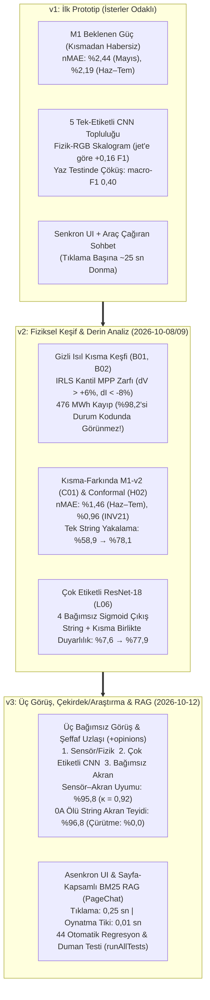
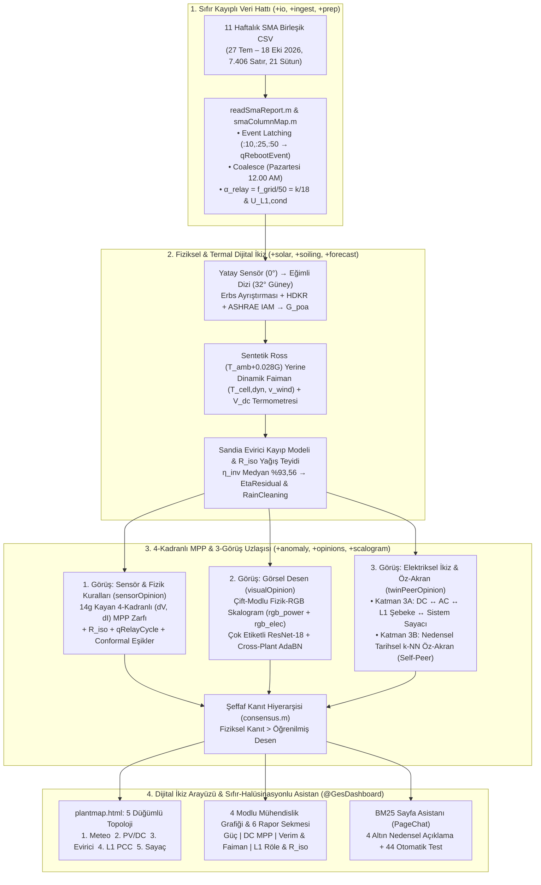

# 00 — Dokümantasyon İndeksi, Claude Referans Mimarisi ve SmartGrid-Twin Dönüşüm Özeti

> **Proje Vizyonu:** Bu dokümantasyon seti, `Claude` referans projesinde (100 eviricili, 4 kabinli, 50 kW Huawei SUN2000 santrali) geliştirilen **Otonom GES Yapay Zekâ İzleme, Kestirimci Bakım, 3-Görüş Uzlaşısı ve Yerel LLM/VLM Dijital İkiz** platformunun tüm kaynak kodlarının, algoritmalarının ve deneysel sonuçlarının derinlemesine analizini; ve bu mimarinin **Akıllı Şebekeler Araştırma Laboratuvarı Akıllı Şebekeler Laboratuvarı (`SmartGridLab — SMA-DATA-1:WR13TL22-8231`, `1.200 kWp`)** sistemine **"Sıfır Atıl Veri (%100 Sütun Kullanımı)"** ilkesiyle uyarlanma tasarımını içerir.

---

## 1. Dokümantasyon Seti İndeksi ve Rehberi

Tüm mimari analiz, matematiksel formülasyonlar, saha bulguları ve kod spesifikasyonları 6 referans doküman halinde yapılandırılmıştır:

| Doküman | Başlık ve Kapsam | İlgili Paketler ve Betikler | Sorumlu Uzman Ajan |
| :--- | :--- | :--- | :--- |
| **[00_INDEX_ve_Genel_Bakis.md](00_INDEX_ve_Genel_Bakis.md)** | Dokümantasyon indeksi, Claude v1/v2/v3 referans mimarisi, 5 uzman ajanın ortak saha keşifleri ve uçtan uca SmartGridLab dönüşüm özeti. | `GES_Baslat.m`, `setupGes.m`, `config/gesConfig.m`, `RAPOR.md`, `makale_taslagi.md` | **Ajan 6** (Baş Dokümantasyon Mimarı) |
| **[01_Veri_Hatti_IO_Ingest_Prep_Runtime.md](01_Veri_Hatti_IO_Ingest_Prep_Runtime.md)** | 11 haftalık SMA CSV (`7.406` ham / `7.397` tekil satır) analizi, 4 veri kaybı tuzağı (`:10/:25/:50` ızgara dışı reset, `12.00 AM` mükerrer birleştirme, $k/18$ röle ortalaması), 21 sütunlu kanonik şema ve `ReplayEngine` sözleşmesi. | `src/+ges/+io/`, `src/+ges/+ingest/`, `src/+ges/+prep/`, `src/+ges/+runtime/`, `scripts/s00..s03`, `v2/a01`, `v2/a02` | **Ajan 1** (Mimari & Veri Hattı Uzmanı) |
| **[02_Fiziksel_Modelleme_Solar_Termal_Kirlenme_Tahmin.md](02_Fiziksel_Modelleme_Solar_Termal_Kirlenme_Tahmin.md)** | Yatay sensör ($\beta=0^\circ$) $\to$ eğimli dizi ($\beta \approx 32^\circ$) Erbs+HDKR+IAM transpozisyonu, sentetik Ross sıcaklığı yerine rüzgar soğutmalı **Dinamik Faiman ($T_{\text{cell,dyn}}$)** + **$V_{dc}$ Termometresi ($T_{\text{cell,vdc}}$)**, Sandia evirici kayıp modeli ve `R_iso` ıslaklık doğrulamalı tozlanma. | `src/+ges/+solar/`, `src/+ges/+soiling/`, `src/+ges/+stats/`, `src/+ges/+forecast/`, `scripts/v2/d01..k02` | **Ajan 2** (Fiziksel Modelleme & Tahmin Uzmanı) |
| **[03_Anomali_Tespiti_3Gorus_Scalogram_DerinOgrenme.md](03_Anomali_Tespiti_3Gorus_Scalogram_DerinOgrenme.md)** | IRLS kantil regresyonlu **4-Kadranlı MPP Zarfı $(dV, dI)$**, M1-v2 kısma-farkında beklenen güç, Mondrian Conformal eşikler, tek evirici için **Katman 3A (Elektriksel İkiz) + Katman 3B (Tarihsel Öz-Akran)** 3. Görüş mimarisi, Çift-Modlu Fizik-RGB Skalogram, Çok Etiketli ResNet-18 ve FedBN/AdaBN. | `src/+ges/+anomaly/`, `src/+ges/+model/`, `src/+ges/+label/`, `src/+ges/+scalogram/`, `src/+ges/+opinions/`, `src/+ges/+federated/`, `scripts/v2/b01..l06`, `v3/m01..m02` | **Ajan 3** (Anomali, 3-Görüş & Derin Öğrenme Uzmanı) |
| **[04_Dashboard_UI_Web_LLM_Ajan_ve_Test_Mimarisi.md](04_Dashboard_UI_Web_LLM_Ajan_ve_Test_Mimarisi.md)** | `@GesDashboard` 8 sekmeli UI mimarisi, `backgroundPool` asenkron LLM/VLM hızlandırması, `plantmap.html` **5 Düğümlü İnteraktif Topoloji Haritası**, 4 modlu mühendislik grafikleri, BM25 Türkçe RAG asistanı (`PageChat`) ve 44 testlik otomatik regresyon paketi. | `app/@GesDashboard/`, `app/web/`, `src/+ges/+agents/`, `src/+ges/+llm/`, `tests/` | **Ajan 4** (Dashboard UI, Web, LLM & Test Uzmanı) |
| **[05_Veri_Maksimizasyonu_Eksikler_ve_Uygulama_Yol_Haritasi.md](05_Veri_Maksimizasyonu_Eksikler_ve_Uygulama_Yol_Haritasi.md)** | 21 CSV sütununun tamamını değerlendiren **Sıfır Atıl Veri Matrisi**, 6 Altın Mühendislik Bulgusu, Claude projesindeki 8 kritik boşluğun (Gap Analysis) çözümü ve 4 fazlı uygulama yol haritası. | Tüm proje paketleri (`+ges/*`, `app/*`, `scripts/*`, `tests/*`) | **Ajan 5** (Eleştirel Denetçi & Veri Maksimizasyonu Uzmanı) |

---

## 2. Claude Referans Projesinin Evrimi (v1 $\to$ v2 $\to$ v3) ve Temel Başarımları

Claude referans projesi, 100 adet 50 kW Huawei eviriciden oluşan 20 aylık (Aralık 2023 – Temmuz 2025, 607 CSV, 3,64 GB) SCADA verisi üzerinde üç evrim aşamasından geçerek olgunlaşmıştır:

---

## 3. Claude Mimarisi ile SmartGrid-Twin (`WR13TL22-8231`) Arasındaki Uçtan Uca Dönüşüm Mimarisi

SmartGrid-Twin Akıllı Şebekeler Laboratuvarı (`SmartGridLab`) veri seti, çoklu kabin/evirici yerine **tek bir evirici (`SMA-DATA-1:WR13TL22-8231`, `1.200 kWp`)** içermekte; buna karşılık Claude projesinde eksik olan **Rüzgar Hızı (`WindSpeed`)**, **DC Yalıtım Direnci (`R_iso`)**, **L1 Şebeke Gerilim/Akım/Frekansı (`U_L1, I_L1, f_grid`)** ve **Aktif Güç Sınırlama/Reset (`SchedP_Pct`)** kanallarını sunmaktadır.

5 uzman ajanımızın ortak çalışmasıyla tasarlanan **Uçtan Uca SmartGridLab v3 Dijital İkiz Mimarisi** aşağıdadır:

---

## 4. Veri Setinde Keşfedilen 6 Altın Mühendislik Bulgusu (Özet Tablo)

| Keşif No | Fiziksel / İstatistiksel Keşif | Ampirik Kanıt (`7.397` Tekil Adım) | Mimariye Etkisi |
| :---: | :--- | :--- | :--- |
| **1** | **Yatay Sensör ($\beta=0^\circ$) vs. Eğimli Dizi ($\beta \approx 32^\circ$)** | Ham $I_{dc}/(G/1000)$ medyanı Ağustos'ta **`4,845`**, Eylül'de **`5,834`**, Ekim'de **`7,307 A/(kW/m²)`** (**+%50,8 artış!**). | Erbs + HDKR + IAM ile `G_poa` ($\beta \approx 32^\circ$) dönüşümü zorunlu kılındı; aylık ölçek kayması $<\%2$'ye indirildi. |
| **2** | **Sentetik Ross `T_mod` ($T_{\text{amb}} + 0.028 G$) ve Rüzgar Soğutması** | `T_mod_sat` ile $T_{\text{amb}} + 0.028 G$ farkı medyan **`0,004 °C`** ($\text{RMSE}=0.036^\circ\text{C}$); oysa yüksek rüzgarda ($v_w \ge 1\text{ m/s}$) gerçek $V_{dc}$ **`+0,83 V`** daha yüksek! | Sütun 19 (`WindSpeed`) kullanan **Dinamik Faiman Hücre Sıcaklığı ($T_{\text{cell,dyn}}$)** ve $V_{dc}$ sanal hücre termometresi ($T_{\text{cell,vdc}}$) devreye alındı. |
| **3** | **18 Alt-Örneklemli ($50\text{ sn}\times 18$) Şebeke Röle Yasası ($k/18$)** | $0 < f_{\text{grid}} < 49\text{ Hz}$ olan **116 adımın tamamında** $f_{\text{grid}} = 50 \cdot (k/18)$ ve $\hat{U}_{L1,\text{cond}} = U_{L1}\cdot(50/f_{\text{grid}})$ medyanı **`228,29 V`**! | $\alpha_{\text{relay}} = f_{\text{grid}}/50$ ile 116 adım `qRelayCycle` olarak ayrıldı (**116 sahte şebeke alarmı önlendi**). |
| **4** | **3 Gerçek Gündüz Kesintisi ve Izgara Dışı (`:10, :25, :50`) Reset İmzası** | `27–31 Temmuz` (`03:10 PM` reset), `29 Ağustos` (`11:30 AM`'de $V_{dc}=230\text{ V}$ MPP$\to V_{\text{oc}}$ sıçraması + `12:25 PM` ve `02:00 PM` reset), `03 Eylül` (`06:50 PM` reset). | Izgara dışı satırları yakalayan `Event Latching` (`qRebootEvent`) ve 4-kadranlı $(dV, dI)$ zarfı için **altın doğrulama vakaları** oluşturuldu. |
| **5** | **Yalıtım Direnci (`R_iso`: `1.153–3.000 kOhm`) Çiğ/Yağış Dinamiği** | Aktif adımların %24'ünde (sabah çiyi ve `28–30 Eylül` yağışlı günler) `R_iso` `1.153–1.350 kOhm`'a düşüp öğlen `3.000 kOhm` tavanına çıkıyor. | Hem `soilingIntervals` içinde **elektriksel yüzey ıslaklığı doğrulamalı yağış tespiti** (`RainCleaning`), hem de kuru öğlede düşük kalırsa **kablo/konnektör erken uyarısı** sağlandı. |
| **6** | **Evirici Verimi ($\eta_{\text{inv}}$), Güç Faktörü ve L1 Thevenin Empedansı ($R_{\text{th}}$)** | $G > 400\text{ W/m}^2$'de medyan $\eta_{\text{inv}} = \mathbf{93,56\%}$, $\text{PF} = \mathbf{0,9999}$, kurulu güç $P_{ac}/P_{\text{spec}} = \mathbf{1,2000\text{ kWp}}$, $U_{L1}$ tepe **`245,06 V`**. | Sandia 3-terimli + gerilim bağımlı evirici kayıp modeli (`EtaResidual`) ve bağlantı noktası Thevenin direnci ($R_{\text{grid,est}} = \partial \hat{U}_{L1,\text{cond}}/\partial I_{L1}$) eklendi. |
