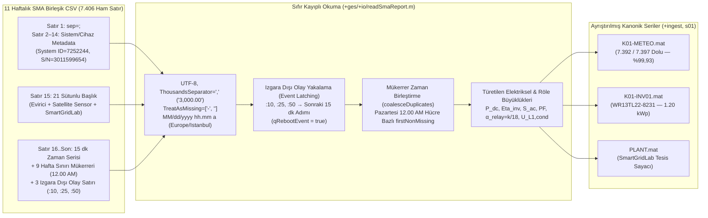

# 01 — Veri Hattı, Girdi/Çıktı, Veri Ambarı, Ön İşleme ve Çalışma Zamanı Mimarisi (`+io`, `+ingest`, `+prep`, `+runtime`, `config`)

> **Kapsam:** Bu doküman, Claude referans projesindeki `config/gesConfig.m`, `src/+ges/+io/`, `src/+ges/+ingest/`, `src/+ges/+prep/`, `src/+ges/+runtime/ReplayEngine.m` ve `scripts/s00..s03`, `v2/a01`, `v2/a02` katmanlarının detaylı teknik analizini; ayrıca **Bursa Teknik Üniversitesi (BTÜ) Akıllı Şebekeler Laboratuvarı (`SmartGridLab — SMA-DATA-1:WR13TL22-8231`, `1.20 kWp`)** 11 haftalık SMA Sunny Portal CSV verilerine uyarlanan **"Sıfır Veri Kaybı (Zero-Data-Loss)"** veri hattı tasarımını referans düzeyinde tanımlar.

---

## 1. SmartGridLab (SMA Sunny Portal) Veri Setinin Ampirik Analizi ve 4 Kritik Veri Kaybı Tuzağı

### 1.1. Dosya Envanteri ve Biçimsel Yapı (Huawei SmartLogger vs. SMA Data Manager M)

| Özellik | Claude Projesi (Huawei SmartLogger) | BTÜ SmartGridLab (SMA Sunny Portal / Data Manager M) |
| :--- | :--- | :--- |
| **Dosya Sayısı ve Dönem** | 601 CSV (Ara 2023 – Tem 2025, 100 evirici) | **11 Haftalık CSV** (`27 Temmuz 2026 00:00 – 18 Ekim 2026 00:00`; `10–15 Ağustos 2026` haftası dışa aktarım boşluğu) |
| **Satır ve Zaman Izgarası** | 52.579 adım × 99 evirici | **7.406 ham satır** (`8` dosyada `673` satır = $7\times 96 + 1$; `3` dosyada `674` satır) $\to$ **7.397 tekil zaman damgası** (`7.394` adet 15-dk adımı + `3` ızgara dışı olay satırı) |
| **Kodlama ve Ayraç** | UTF-16LE (`255, 254` BOM), `\t` (TAB) | UTF-8, 1. satır `sep=;`, 2–14. satırlar `"Key";"Value"` üstveri, 15. satır 21 sütunlu başlık |
| **Tablo Mimarisi** | Her parametre grubu (`power`, `grid`, `status`, `pvVoltage`, `pvCurrent`, `cabinetTemp`, `meteo`, `plant`) ayrı CSV dosyasında | **Birleşik (`sma_combined`):** Tek CSV içinde Evirici (`SMA-DATA-1:WR13TL22-8231`), Harici Sensör (`Satellite Sensor`) ve Sistem (`SmartGridLab`) sütunları yan yana |
| **Zaman Damgası Biçimi** | `yyyy-MM-dd HH:mm:ss` | `"MM/dd/yyyy hh.mm AM/PM"` (`Locale="en_US"`, `TimeZone="Europe/Istanbul"`) |
| **Eksik Veri ve Sayısal Biçim** | `NaN` / boş hücre | Eksik/gece hücreleri `"-"`; Sütun 13 (`Insulation resistance [kOhm]`) `"1,284.00"` ve `"3,000.00"` şeklinde **virgül binlik ayraçlı (`ThousandsSeparator=","`)** |

---

### 1.2. Veri Hattını Doğrudan Etkileyen 4 Kritik Saha Tuzağı ve Mimari Çözümleri

1. **TUZAK 1 — Izgara Dışı (`OffGridTimes`) Reset Satırlarının `retime` Tarafından Silinmesi:**
   * **Sorun:** Claude'daki `loadDevice.m` fonksiyonu `retime(TT, "regular", "fillwithmissing", TimeStep=minutes(15))` çağrısı yapar. Bu çağrı, `00, 15, 30, 45` dakikalarına tam oturmayan satırları **sessizce siler**.
   * **Ampirik Kanıt:** Sütun 20 (`Active power limitation set value [%] / SmartGridLab`) 7.406 satırın yalnızca 26'sında `"0.00"` değerini alır (diğerlerinde `"-"`). Bunların 22'si hafta başı/sonu `12.00 AM` kayıtları iken, **4 tanesi gündüz yaşanan gerçek evirici kesintilerinin tam sona erdiği anda** düşmüştür ve **3 tanesi 15 dakikalık ızgara dışındadır (`:10`, `:25`, `:50`):**
     * **Olay A (`27–31 Temmuz 2026`):** Evirici 4,5 gün boyunca tam güneş altında (`G = 850–950 W/m²`) kapalıdır (`"-"`), yalnızca `29 Temmuz 11:45 AM`'de tek adımlık uyanma denemesi vardır (`V_dc = 238 V, I_dc = 0.014 A, R_iso = 1153 kOhm, U_L1 = 0 V`). **`07/31/2026 03.10 PM`** (`:10` ızgara dışı!) adımında `SchedP_Pct = 0.00` kaydı düşer ve `03.15 PM`'de evirici devreye girer (`0.02 kW` $\to$ `0.63 kW`).
     * **Olay B (`29 Ağustos 2026 11:00 AM – 02:15 PM`):** Açık havada (`G = 600–690 W/m²`) saat `11:00–11:45 AM` arasında güç kısılır (`11:30 AM`'de `V_dc = 230 V` açık devreye sıçrar, `I_dc = 0.015 A`), `12:00–12:15 PM`'de evirici kapanır (`"-"`), **`08/29/2026 12.25 PM`** (`:25` ızgara dışı!) adımında `SchedP_Pct = 0.00` düşer ve `12:30 PM`'de yeniden başlar. Saat `01:30–01:45 PM`'de tekrar kapanır, **`08/29/2026 02.00 PM`** adımında tekrar `SchedP_Pct = 0.00` düşer ve `02:15 PM`'de devreye girer.
     * **Olay C (`03 Eylül 2026 05:15 PM – 07:00 PM`):** Evirici `05:00 PM`'de `0.40 kW` (`G = 446 W/m²`) üretirken `05:15–06:45 PM` arasında kapanır (`"-"`), **`09/03/2026 06.50 PM`** (`:50` ızgara dışı!) adımında `SchedP_Pct = 0.00` düşer ve `07:00 PM`'de yeniden şebekeye bağlanır.
   * **Mimari Çözüm (`Event Latching`):** Izgara dışı (`mod(minute(t), 15) ~= 0`) satırlar asla silinmez; `retime` öncesinde bir sonraki 15 dk ızgara noktasına (`ceilTo15Min`) taşınarak `SchedP_Pct` değeri korunur ve `qRebootEvent = true` (`qResetEvent`) bayrağı tetiklenir.

2. **TUZAK 2 — Hafta Başı (`Pazartesi 12.00 AM`) Mükerrer Zaman Damgalarında Kısmi Satır Ezilmesi:**
   * **Sorun:** Her haftalık CSV'nin ilk satırı (`Pazartesi 12.00 AM`) tüm sensör sütunlarında `"-" ` (`NaN`), yalnızca `SchedP_Pct` sütununda `"0.00"` içerir. Önceki haftanın son satırı olan aynı `Pazartesi 12.00 AM` ise `T_mod`, `T_amb`, `G=0`, `WindSpeed` ölçümlerini içerir ancak `SchedP_Pct` sütunu `"-"`'dir. `unique(TT.Time, "stable")` kullanılırsa iki satırdan biri ezilir.
   * **Mimari Çözüm (`coalesceDuplicates`):** Mükerrer zaman damgalarında sütun bazlı **`firstNonMissing`** birleştirmesi uygulanarak her iki satırdaki dolu hücreler tek satırda birleştirilir.

3. **TUZAK 3 — 18 Alt-Örneklemli ($50\text{ sn} \times 18 = 15\text{ dk}$) Röle Ortalaması ve Sabah PLL Senkronizasyonu:**
   * **Sorun:** Veride $0 < f_{\text{grid}} < 49.0\text{ Hz}$ olan **116 adımın tamamında** frekans değerleri $50\text{ Hz} \times (k/18)$ (`8.34, 16.67, 33.33, 41.67 Hz`) ve gerilim değerleri $230\text{ V} \times (k/18)$ şeklindedir.
   * **Mimari Çözüm:** `RelayDuty = min(max(f_grid / 50.0, 0), 1)` ($\alpha_{\text{relay}} = k/18$) ve koşullu şebeke gerilimi `U_L1_cond = V_grid ./ max(RelayDuty, eps)` (116 adımda medyanı **228,29 V**) hesaplanır; bu adımlar `qRelayCycle` / `qWakeup` olarak sınıflandırılır ve sahte şebeke arızası üretmesi engellenir.

4. **TUZAK 4 — Yatay Sensör ($\beta=0^\circ$) vs. Eğimli Dizi ($\beta \approx 32^\circ$) ve Sentetik Ross `T_mod`:**
   * Sütun 17 (`G`) yatay ışınımdır (`GHI`); dizi düzlemine transpoze edilmiş **`G_poa` (`G_ref`)** üretilir.
   * Sütun 14 (`T_mod`) ve Sütun 18 (`T_mod_sys`) birebir aynıdır ve $T_{\text{amb}} + 0.028 G$ statik Ross formülüdür; Sütun 19 (`WindSpeed`) kullanılarak **Dinamik Faiman Hücre Sıcaklığı (`T_cell_faiman`)** üretilir.

---

## 2. 21 Sütunun Tamamını İçeren "Sıfır Veri Kaybı" Kanonik Şeması (`smaColumnMap.m`)

| Sütun (1-Bazlı) | Orijinal SMA Sunny Portal Başlığı | `columnKey` Anahtarı | Kanonik Ad (`TT`) | Birim | Doluluk (`7406` satır) | Değer Aralığı (Min – Max, Ort.) | Rol (`Role`) ve Türetilen Büyüklükler |
| :---: | :--- | :--- | :--- | :---: | :---: | :--- | :--- |
| **1** | `Time period` | `timeperiod` | `Time` | datetime | `7406 / 7406` | `27.07.2026` – `18.10.2026` | Zaman indeksi (`MM/dd/yyyy hh.mm a`, `Europe/Istanbul`). |
| **2** | `Power [kW] / SMA-DATA-1:WR13TL22-8231` | `powerkwsmadata1wr13tl228231` | `P_ac` | `kW` | `3599 / 7406` | `0.00` – `1.01` (`0.371`) | `inverter` — Evirici aktif AC çıkış gücü. |
| **3** | `Specific AC power [kW/kWp] / SMA-DATA-1:WR13TL22-8231` | `specificacpowerkwkwpsmadata1wr13tl228231` | `P_ac_spec` | `kW/kWp` | `3599 / 7406` | `0.00` – `0.84` (`0.309`) | `inverter` — $P_{ac}/P_{ac,\text{spec}} \equiv 1.200\text{ kWp}$ kurulu gücü doğrular. |
| **4** | `Grid voltage phase L1 [V] / SMA-DATA-1:WR13TL22-8231` | `gridvoltagephasel1vsmadata1wr13tl228231` | `V_grid` (`U_L1`) | `V` | `3599 / 7406` | `0.00` – `245.06` (`231.80`) | `inverter` — L1 faz gerilimi; `U_L1_cond = V_grid / RelayDuty`. |
| **5** | `Grid voltage phase L2 [V] / SMA-DATA-1:WR13TL22-8231` | `gridvoltagephasel2vsmadata1wr13tl228231` | `U_L2` | `V` | `3599 / 7406` | `0.00` – `0.00` (`0.000`) | `inverter` — Tek fazlı topoloji doğrulaması (`info.Phases = 1`). |
| **6** | `Grid voltage phase L3 [V] / SMA-DATA-1:WR13TL22-8231` | `gridvoltagephasel3vsmadata1wr13tl228231` | `U_L3` | `V` | `3599 / 7406` | `0.00` – `0.00` (`0.000`) | `inverter` — Tek fazlı topoloji doğrulaması. |
| **7** | `Grid current phase L1 [A] / SMA-DATA-1:WR13TL22-8231` | `gridcurrentphasel1asmadata1wr13tl228231` | `I_grid` (`I_L1`) | `A` | `3599 / 7406` | `0.000` – `4.259` (`1.573`) | `inverter` — $P_{\text{grid,app}} = V_{\text{grid}}I_{\text{grid}}/1000$ (kVA) ve `PF`. |
| **8** | `Grid current phase L2 [A] / SMA-DATA-1:WR13TL22-8231` | `gridcurrentphasel2asmadata1wr13tl228231` | `I_L2` | `A` | `3599 / 7406` | `0.000` – `0.000` (`0.000`) | `inverter` — Tek fazlı akım doğrulaması. |
| **9** | `Grid current phase L3 [A] / SMA-DATA-1:WR13TL22-8231` | `gridcurrentphasel3asmadata1wr13tl228231` | `I_L3` | `A` | `3599 / 7406` | `0.000` – `0.000` (`0.000`) | `inverter` — Tek fazlı akım doğrulaması. |
| **10** | `Grid frequency [Hz] / SMA-DATA-1:WR13TL22-8231` | `gridfrequencyhzsmadata1wr13tl228231` | `f_grid` | `Hz` | `3599 / 7406` | `0.00` – `50.06` (`49.487`) | `inverter` — `RelayDuty = clip(f_grid/50, 0, 1)` ($k/18$ röle yasası). |
| **11** | `DC voltage input [V] / SMA-DATA-1:WR13TL22-8231` | `dcvoltageinputvsmadata1wr13tl228231` | `V_dc` (`V_pv1`) | `V` | `3599 / 7406` | `149.00` – `256.00` (`199.98`) | `inverter` — DC dizi gerilimi, `mppEnvelope` ve `T_cell_vdc`. |
| **12** | `DC current input [A] / SMA-DATA-1:WR13TL22-8231` | `dccurrentinputasmadata1wr13tl228231` | `I_dc` (`I_pv1`) | `A` | `3599 / 7406` | `0.013` – `5.901` (`2.103`) | `inverter` — $P_{dc} = V_{dc}I_{dc}/1000$ (kW), tek-string `I_norm` ve `SR`. |
| **13** | `Insulation resistance [kOhm] / SMA-DATA-1:WR13TL22-8231` | `insulationresistancekohmsmadata1wr13tl228231` | `R_iso` | `kOhm` | `3599 / 7406` | `1153.0` – `3000.0` (`2594.98`) | `inverter` — Sabah çiyi/nem (`1153–1350 kOhm`) ve yalıtım sağlığı. |
| **14** | `Module temperature [°C] / Satellite Sensor` | `moduletemperaturecsatellitesensor` | `T_mod_sat` (`T_mod`) | `°C` | `7392 / 7406` | `9.0` – `60.6` (`27.861`) | `meteo` — 24 saat kesintisiz Ross sıcaklığı ($T_{\text{amb}} + 0.028G$). |
| **15** | `Power [kW] / SmartGridLab` | `powerkwsmartgridlab` | `P_ac_sys` | `kW` | `3599 / 7406` | `0.00` – `1.01` (`0.371`) | `plant` — Tesis sayacı gücü ($\Delta P = P_{ac} - P_{ac,\text{sys}} \equiv 0$). |
| **16** | `System ambient temperature [°C] / SmartGridLab` | `systemambienttemperaturecsmartgridlab` | `T_amb` | `°C` | `7392 / 7406` | `9.0` – `34.7` (`21.660`) | `meteo` — 24 saat kesintisiz ortam sıcaklığı. |
| **17** | `System insolation on external sensor [W/m²] / SmartGridLab` | `systeminsolationonexternalsensorwmsmartgridlab` | `G_horiz` (`G` $\to$ `G_poa`) | `W/m^2` | `7392 / 7406` | `0` – `974` (`221.468`) | `meteo` — Yatay ışınım ($\beta=0^\circ$); `G_poa` ($\beta \approx 32^\circ$) üretir. |
| **18** | `System module temperature [°C] / SmartGridLab` | `systemmoduletemperaturecsmartgridlab` | `T_mod_sys` | `°C` | `7392 / 7406` | `9.0` – `60.6` (`27.861`) | `meteo` — `resolveMeteo` içinde `T_mod_sat` için yedek/doğrulama kanalı. |
| **19** | `System wind speed [m/s] / SmartGridLab` | `systemwindspeedmssmartgridlab` | `WindSpeed` (`W_spd`) | `m/s` | `7392 / 7406` | `0.00` – `2.90` (`0.797`) | `meteo` — 24 saat kesintisiz rüzgar hızı; `T_cell_faiman` girdisi. |
| **20** | `Active power limitation set value [%] / SmartGridLab` | `activepowerlimitationsetvaluesmartgridlab` | `SchedP_Pct` | `%` | `26 / 7406` | `0.00` – `0.00` (`0.000`) | `control` — Dışsal güç sınırı (`qPowerLimit`) ve reset (`qRebootEvent`). |
| **21** | `Specific AC power [kW/kWp] / SmartGridLab` | `specificacpowerkwkwpsmartgridlab` | `P_ac_spec_sys` | `kW/kWp` | `3599 / 7406` | `0.00` – `0.84` (`0.309`) | `plant` — Sistem düzeyi özgül güç (`P_ac_spec` çapraz kontrolü). |

---

## 3. Paket ve Fonksiyon Bazlı Detaylı Uyarlama Spesifikasyonu

### 3.1. Merkezi Yapılandırma (`config/gesConfig.m`)
* **Tesis ve Cihaz Sabitleri:**
  * `cfg.data.vendor = "SMA"` (`"Huawei"` | `"SMA"` | `"auto"`).
  * `cfg.data.ratedAcPower = 1.20` (`kW` / kurulu güç $1.20\text{ kWp}$), `cfg.data.numPhases = 1`, `cfg.data.numMppts = 1`, `cfg.data.numStrings = 1`, `cfg.data.meteoCabins = 1`.
  * `cfg.site.name = "BTÜ SmartGridLab GES"`, `cfg.site.latitude = 40.1878`, `cfg.site.longitude = 29.1289`, `cfg.site.altitude = 155` (Bursa Teknik Üniversitesi Mimar Sinan Yerleşkesi).
* **Sızıntısız Kronolojik Blok Bölmesi (`cfg.split`):**
  * Tek evirici olduğu için `cfg.split.holdoutDevices = strings(0,1)` yapılır ve **haftalık dosya bazlı kronolojik ayrım** uygulanır:
    * **Eğitim (`train`):** `27 Temmuz 2026 – 19 Eylül 2026` (ilk 7 hafta, ~4.700 adım; 3 gerçek kesinti/reset olayı dahil).
    * **Doğrulama (`validationStart`):** `datetime(2026, 9, 20, TimeZone="Europe/Istanbul")` (`20 Eylül – 03 Ekim 2026`, 2 hafta).
    * **Hold-Out Test (`testStart`):** `datetime(2026, 10, 4, TimeZone="Europe/Istanbul")` (`04 Ekim – 18 Ekim 2026`, son 2 hafta — görülmemiş sonbahar dönemi).

---

### 3.2. Veri Okuma ve Sınıflandırma Paketi (`src/+ges/+io/`)

1. **`ges.io.columnKey.m` & `ges.io.smaColumnMap.m` (Yeni):**
   * `columnKey.m` küçük harfe çevirip ASCII dışı karakterleri (`[^a-z0-9]`) temizler (`[W/m²]` $\to$ `wm`).
   * `smaColumnMap.m`, Bölüm 2'deki 20 veri sütununun `(Key, Name, Unit, Role)` eşlemesini döndürür ve genel SMA dışa aktarımları için cihaz soneklerini (`" / SMA-DATA-.*$"`, `" / SmartGridLab$"`, `" / Satellite Sensor$"`) soyarak (`stripDeviceSuffix`) donanımdan bağımsız eşleştirme yapar.
2. **`ges.io.readSmaReport.m` (Yeni — `readHuaweiReport.m` Muadili):**
   * İlk 15 satırdan `sep=;` ayracını ve `Meta` yapısını (`SystemName`, `DeviceName`, `SerialNumber`, `TimeZone`) okur.
   * Veri satırlarında `"-"` değerlerini `NaN` yapar, Sütun 13 (`R_iso`) gibi binlik ayracı `","` içeren sayıları `erase(str, ",")` ile kayıpsız `double` türüne çevirir.
   * Türetilen elektriksel sütunları (`P_dc`, `Eta_inv`, `Eff`, `P_grid_app`, `Q_grid`, `PF`, `RelayDuty`, `U_L1_cond`) ve geriye dönük takma adları (`V_pv1 = V_dc`, `I_pv1 = I_dc`, `U_L1 = V_grid`, `I_L1 = I_grid`, `W_spd = WindSpeed`) anında ekler.
3. **`ges.io.classifyByHeader.m`, `ges.io.parseDeviceName.m` ve `ges.io.scanReports.m`:**
   * `classifyByHeader.m`: İlk 2 bayt `255, 254` (UTF-16LE BOM) değilse UTF-8 okur; ilk satır `sep=;` ise veya ilk 20 satırda `"Time period"` ve `"SMA-DATA"` geçiyorsa `kind = "sma_combined"` döndürür.
   * `scanReports.m` ve `parseDeviceName.m`: Birleşik SMA CSV dosyalarını (`Analysis Pro - Week - *.csv`) katalogda **3 mantıksal cihaz kaydına** (`Kind = "meteo"` $\to$ `Id = "K01-METEO"`, `Kind = "inverter"` $\to$ `Id = "K01-INV01"` / `Device = "WR13TL22-8231"`, `Kind = "plant"` $\to$ `Id = "PLANT"`) genişletir.
4. **`ges.io.loadDevice.m`:**
   * **Izgara Dışı Olay Yakalama (`Event Latching`):** `~onGrid` (`:10, :25, :50`) satırlarını bir sonraki 15 dk adımına yuvarlar ve `qRebootEvent = true` bayrağıyla birleştirir.
   * **Mükerrer Zaman Damgası Hücre Birleştirme (`coalesceDuplicates`):** Hafta sınırındaki (`Pazartesi 12.00 AM`) mükerrer zamanlarda her sütun için `firstNonMissing` değerini alır.

---

### 3.3. Veri Ambarı (`src/+ges/+ingest/`) ve Ön İşleme (`src/+ges/+prep/`) Paketi

| Fonksiyon | Mevcut Claude Davranışı | SmartGridLab Uyarlaması |
| :--- | :--- | :--- |
| **`fileSpan.m` & `catalogFiles.m`** | Yalnız UTF-16LE ve `yyyy-MM-dd HH:mm:ss` okur; 4 ayrı dosya türü bekler. | UTF-8 + `"MM/dd/yyyy hh.mm a"` regex'i destekler; tek bir `sma_combined` dosyasından otomatik olarak `meteo`, `inverter` ve `plant` katalog satırlarını üretir. |
| **`plantState.m` & `buildWorkspace.m`** | Kapasiteyi P99,9 AC güçten tahmin eder; `meteoRef` içinde rüzgar yok. | `Capacity = median(P_ac ./ P_ac_spec, "omitmissing") = 1.200 kWp` analitik olarak belirlenir; `meteoRef` içine `G_horiz`, `G_poa`, `WindSpeed`, `T_mod_sat`, `T_mod_sys`, `T_cell_faiman` eklenir. |
| **`statusFlags.m`** | Yalnız Huawei metinsel `Status` sütununa bakar. | `Status` sütunu yoksa elektriksel sinyallerden hibrit bayrak üretir: `qWakeup`, `qRelayCycle`, `qOnGrid`, `qPowerLimit`, `qRebootEvent`, `qGridLoss`, `qFault` (`R_iso < 500` dahil). |
| **`stringFeatures.m`** | `cur ./ median(cur, 2)` (8 stringli evirici varsayımı). | Tek string (`nnz(installed) == 1`) olduğunda fiziksel zarftan gelen beklenen akım `I_exp_ref` ile normalize eder (`Norm = I_dc ./ max(I_exp_ref, 0.2)`). |
| **`dailySummary.m`** | Günlük `E_dc, E_ac, H_ref, Kd, VI, SkyClass` üretir. | Ek olarak `H_horiz, H_poa, Wind_mean, Wind_max, T_cell_faiman_max, DeltaT_cooling, Eta_med, R_iso_min, R_iso_morning, V_grid_min/max, ResetEvents, PR_poa` üretir. |

---

### 3.4. Çalışma Zamanı Motoru (`src/+ges/+runtime/ReplayEngine.m`) ve Betikler (`s00..s03`, `a01`, `a02`)

1. **`ReplayEngine.m` Güncellemeleri:**
   * Sabit `* 0.25`, `minSteps = 4`, `sustainSteps = 8` yerine dinamik `obj.DtHours = hours(median(diff(obj.Times)))`, `obj.MinSteps = round(1/obj.DtHours)`, `obj.SustainSteps = round(2/obj.DtHours)` özellikleri tanımlanır.
   * Bellekte (`single` matrisler olarak, `7397 × 1` için yalnızca ~30 KB/vektör) `Pact`, `Pac`, `PacSpec`, `Eff`, `Pexp`, `PexpWork`, `Vdc`, `Idc`, `Vgrid`, `VgridCond`, `Igrid`, `Fgrid`, `AlphaRelay`, `PgridApp`, `PF`, `Riso`, `Gref` (`G_poa`), `Ghoriz`, `Tmod`, `Tcell`, `Tamb`, `Tcab`, `Wind`, `SchedP`, `ResetEvt` tutulur ve `series(id, t0, t1)` ile eksiksiz döndürülür.
2. **Temel Betiklerin (`scripts/`) Dönüşümü:**
   * **`s00_create_holdout.m`:** Son 2 haftalık CSV dosyasını (`04–10 Ekim` ve `11–17 Ekim 2026`, `1.346` satır) `data_holdout/` klasörüne ayırır ve hafta sınırı `10/04/2026 12.00 AM` ortak satırını sızıntısız keser.
   * **`s01_build_dataset.m`:** Birleşik SMA CSV'lerinden `K01-METEO.mat`, `K01-INV01.mat` ve `PLANT.mat` dosyalarını üretir.
   * **`s02_estimate_orientation.m` & `v2/a02_orientation_v2.m`:** Sensör düzlemini $\beta_{\text{sen}} \approx 0^\circ$ (yatay) ve PV dizi düzlemini $\beta_{\text{arr}} \approx 32^\circ, \gamma_{\text{arr}} \approx 178^\circ$ (Ağustos–Ekim arasındaki +%50,8 yatay akım kaymasını sıfırlayan eğim) olarak kalibre eder.
   * **`s03_build_features.m` & `v2/a01_data_inventory.m`:** 21 sütunun doluluk, sayaç mutabakatı ($\Delta P_{\text{sys}} = 0.000\text{ kW}$), $\eta_{\text{inv}}$ medyanı (**%93,56**), 116 adımda $\alpha_{\text{relay}} = k/18$ röle yasası ve `R_iso` sabah çiyi profilini otomatik denetler ve kaydeder.
