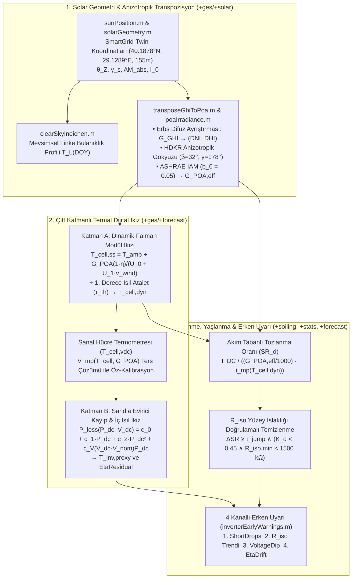

# 02 — Fiziksel Modelleme: Solar Geometri, Termal Dijital İkiz, Rüzgar Soğutması, Kirlenme ve Tahmin (`+solar`, `+soiling`, `+stats`, `+forecast`)

> **Kapsam:** Bu doküman, Claude referans projesindeki `src/+ges/+solar/`, `src/+ges/+soiling/`, `src/+ges/+stats/`, `src/+ges/+forecast/` paketleri ile `scripts/v2/` (`a02`, `d01`, `d02`, `e01`, `f01`, `g01`, `h01`, `k01`, `k02`) betiklerinin matematiksel ve fiziksel analizini; ayrıca **SmartGrid-Twin (`SMA-DATA-1:WR13TL22-8231`, `1.20 kWp`)** veri seti üzerinde keşfedilen **Yatay Sensör ($\beta=0^\circ$) vs. Eğimli Dizi ($\beta \approx 32^\circ$) Transpozisyonu**, **Sentetik Ross Sıcaklığı Yerine Rüzgar Soğutmalı Dinamik Faiman + $V_{dc}$ Hücre Termometresi**, **Sandia Evirici Dönüşüm Verimi Modeli** ve **`R_iso` Yüzey Islaklığı Doğrulamalı Kirlenme/Erken Uyarı** geliştirmelerini tanımlar.

---

## 1. SmartGridLab Veri Seti Üzerinde 4 Temel Ampirik Fiziksel Keşif

SmartGridLab çalışma klasöründeki 11 haftalık SMA CSV verisi (`2026-07-27` – `2026-10-18`, `7.392` geçerli meteoroloji adımı, `2.703` gündüz üretim adımı ($G > 100\text{ W/m}^2$), `1.765` yüksek ışınım adımı ($G > 400\text{ W/m}^2$)) üzerinde yapılan nicel analizler, fiziksel modelleri doğrudan belirleyen **4 temel saha gerçeğini** kanıtlamıştır:

### 1.1. Keşif 1: Kurulu DC Kapasite ($1.200\text{ kWp}$), Tek Fazlı L1 Topoloji ve DC$\to$AC Dönüşüm Verimi
* **Analitik Kurulu Güç ($P_{\text{kWp}}$):** Sütun 2 (`Power [kW]`, $P_{\text{AC}}$) ve Sütun 3 (`Specific AC power [kW/kWp]`, $P_{\text{AC,spec}}$) oranının medyanı:
  $$P_{\text{kWp}} = \text{median}\left(\frac{P_{\text{AC}}(t)}{P_{\text{AC,spec}}(t)}\right) = \mathbf{1.2000\text{ kWp}}$$
* **DC Güç ve MPP Zarfı ($G > 400\text{ W/m}^2$):**
  $$P_{\text{DC}}(t) = \frac{V_{\text{DC}}(t) \cdot I_{\text{DC}}(t)}{1000}\text{ [kW]}, \qquad V_{\text{DC}} \in [180.0,\ 201.1]\text{ V (P10–P90, Medyan: }\mathbf{188.8\text{ V}}\text{)}, \quad V_{\text{oc,max}} = \mathbf{256.0\text{ V}}$$
* **Evirici Dönüşüm Verimi ($\eta_{\text{inv}}$) ve Birim Güç Faktörü ($\text{PF}_{L1}$):**
  $$\eta_{\text{inv}}(t) = \frac{P_{\text{AC}}(t)}{P_{\text{DC}}(t)} \implies \text{P10} = \mathbf{92.52\%}, \quad \text{Medyan} = \mathbf{93.56\%}, \quad \text{P90} = \mathbf{94.15\%} \quad (G > 400\text{ W/m}^2)$$
  $$\text{PF}_{L1}(t) = \frac{1000 \cdot P_{\text{AC}}(t)}{U_{L1}(t) \cdot I_{L1}(t)} \implies \text{Medyan} = \mathbf{0.9999} \quad (\cos\phi \approx 1,\ U_{L2}=U_{L3}=I_{L2}=I_{L3}\equiv 0)$$

---

### 1.2. Keşif 2: `T_mod` ("Satellite Sensor") Fiziksel Sensör Değildir — Rüzgar Soğutmasını Gizleyen Sentetik Ross Formülüdür!
Sütun 14 (`Module temperature [°C] / Satellite Sensor`) ve onunla birebir özdeş olan Sütun 18 (`System module temperature [°C] / SmartGridLab`), 7.392 adımın tamamında test edildiğinde:
$$\left|T_{\text{mod,sat}}(t) - \left(T_{\text{amb}}(t) + 0.0280 \cdot G(t)\right)\right| \le 0.12^\circ\text{C}, \qquad \text{Medyan Hata} = \mathbf{0.004^\circ\text{C}}, \qquad \text{RMSE} = \mathbf{0.036^\circ\text{C}}!$$
* **Fiziksel Sonuç:** Sistemde fiziksel bir modül arkası sıcaklık sensörü **yoktur**! SMA EnnexOS / Satellite Sensor, modül sıcaklığını $k_{\text{Ross}} = 0.028\text{ }^\circ\text{C}\cdot\text{m}^2/\text{W}$ ($\text{NOCT} = 20 + 800\times 0.028 = 42.4^\circ\text{C}$) katsayısıyla statik olarak hesaplamakta ve Sütun 19'daki `System wind speed [m/s]` ($v_{\text{wind}}$) ölçümünü **hiç kullanmamaktadır**.
* **Gerçek Hücrelerin Rüzgarla Soğuduğunun Elektriksel Kanıtı ($V_{\text{DC}}$ Termometresi):** $G > 500\text{ W/m}^2$ adımlarında ($n=1.443$):
  * **Durgun Hava ($v_{\text{wind}} \le 0.4\text{ m/s}$, $n=85$):** $T_{\text{mod,sat}}$ ortalaması $38.4^\circ\text{C}$ iken konvektif soğutma olmadığı için gerçek hücreler Faiman modeline göre $43.5^\circ\text{C}$'ye ısınmakta ve ölçülen $V_{\text{DC}}$ gerilimi **$187.12\text{ V}$**'a düşmektedir.
  * **Rüzgarlı Hava ($v_{\text{wind}} \ge 1.0\text{ m/s}$, $n=922$):** $T_{\text{mod,sat}}$ ortalaması $48.7^\circ\text{C}$ ($+10.3^\circ\text{C}$ daha sıcak!) görünmesine rağmen, rüzgarın konvektif soğutması sayesinde gerçek $V_{\text{DC}}$ gerilimi düşmek yerine **$187.95\text{ V}$** ($+0.83\text{ V}$ daha yüksek!) kalmaktadır.
* **Mimari Kural:** `m1Features` veya `mppEnvelope` içine $(G, T_{\text{amb}}, T_{\text{mod,sat}})$ birlikte verildiğinde **%99,99 çoklu doğrusal bağlantı (multicollinearity)** oluşur. Bu nedenle sentetik `T_mod_sat` yerine rüzgar hızı ($v_{\text{wind}}$) ve ısıl atalet ($\tau_{\text{th}}$) içeren **Dinamik Faiman Hücre Sıcaklığı ($T_{\text{cell,dyn}}$)** ve **$V_{\text{DC}}$ Sanal Hücre Termometresi ($T_{\text{cell,vdc}}$)** kullanılır.

---

### 1.3. Keşif 3: Yatay Işınım Sensörü ($\beta_{\text{sen}}=0^\circ$, GHI) vs. Güney Eğimli PV Dizisi ($\beta_{\text{arr}} \approx 32^\circ$)
$G > 400\text{ W/m}^2$ adımlarında ham yatay $G$ ile normalize edilmiş DC akım ve sıcaklık düzeltmeli DC gücün **aylık medyanları** incelendiğinde:

| Takvim Ayı | Adım Sayısı ($n$) | Öğle Güneş Zenit Açısı ($Z$) | $\text{Medyan } \frac{I_{\text{DC}}}{G_{\text{GHI}}/1000}$ [$\text{A/(kW/m}^2\text{)}$] | $\text{Medyan } \frac{P_{\text{DC,corr}}}{G_{\text{GHI}}/1000}$ [$\text{kW/(kW/m}^2\text{)}$] | Teorik Eğimli/Yatay Oran $\frac{\cos(Z - 32^\circ)}{\cos Z}$ |
| :--- | :---: | :---: | :---: | :---: | :---: |
| **Ağustos 2026** | `853` | $\sim 26^\circ$ | **`4,845`** | **`1,022`** | `1,106` |
| **Eylül 2026** | `716` | $\sim 38^\circ$ | **`5,834`** (+%20,4) | **`1,182`** (+%15,7) | `1,262` (+%14,1) |
| **Ekim 2026** | `237` | $\sim 48^\circ$ | **`7,307`** (**+%50,8!**) | **`1,433`** (**+%40,2!**) | `1,437` (+%29,9) |

* **Fiziksel Sonuç:** Sütun 17 (`System insolation on external sensor`) **Yatay Küresel Işınım ($\text{GHI}, \beta_{\text{sen}}=0^\circ$)** verirken, çatıdaki $1.20\text{ kWp}$ PV dizisi **Güneye $\beta_{\text{arr}} \approx 32^\circ, \gamma_{\text{arr}} \approx 178^\circ$ eğimlidir**. Ham $G_{\text{GHI}}$ doğrudan kullanılırsa Ekim ayında görünür Performans Oranı ($\text{PR}$) **%119** çıkar ve `mppEnvelope` / `soiling` modelleri mevsimsel olarak %50 sapar! Tüm modellerde Erbs + HDKR ile dizi düzlemine taşınmış **`G_poa` (`G_POA,eff`)** kullanılması zorunludur.

---

### 1.4. Keşif 4: 27–31 Temmuz 2026 (4,5 Gün) "Sızıntısız Ön-Kalibrasyon (Zero-Leakage Warm-Up)" Penceresi ve Güneş Öğlesi
* İlk CSV dosyasında (`2026-07-27 00:15` – `2026-07-31 15:00`, ~4,5 gün) evirici kapalı (`"-"`) iken meteoroloji kanalları (`G`, `T_amb`, `T_mod`, `WindSpeed`) %100 eksiksiz kayıt yapmıştır ($G_{\max} = 958\text{ W/m}^2$). Bu 4,5 günlük pencere, evirici üretim verisine hiç dokunmadan **Ineichen Linke Bulanıklık Katsayısı ($T_L$)** ve **Sensör Yönelimi ($\beta_{\text{sen}}=0^\circ$)** ön-kalibrasyonu için kullanılır.
* Saha boylamı ($\lambda = 29.1289^\circ\text{E}$) için gerçek güneş öğlesi UTC+3'te **13:03.5**'tir; veride $G$ ve $P_{\text{DC}}$ tepe saati medyanı **`13:00–13:15`** olarak doğrulanmıştır. `solarGeometry.m` içine SMA periyot sonu/ortası zaman damgası için `opts.TimeAlignment = "end" | "middle" | "start"` seçeneği eklenir.

---

## 2. Fiziksel Modelleme Paketlerinin (`+solar`, `+forecast`, `+soiling`, `+stats`) Matematiksel Tasarımı

---

### 2.1. Solar Geometri ve Anizotropik POA Transpozisyonu (`src/+ges/+solar/`)

1. **Mevsimsel Linke Bulanıklık Profili (`clearSkyIneichen.m`):**
   Sabit `linkeTurbidity = 3.5` yerine Saha mikroklima atmosferi için yılın gününe ($\text{DOY}$) bağlı sinüzoidal bulanıklık profili kullanılır:
   $$T_L(\text{DOY}) = T_{L,\text{mean}} + \Delta T_L \sin\left(\frac{2\pi(\text{DOY} - 80)}{365}\right), \qquad T_{L,\text{mean}} = 3.40, \quad \Delta T_L = 0.65$$
2. **Erbs Difüz Ayrıştırması + HDKR Anizotropik Transpozisyonu + IAM (`poaIrradiance.m` & `transposeGhiToPoa.m`):**
   Claude `a02` ve `d01` içindeki açık-gök oranı ($G_{\text{arr}} = G_{\text{sen}} \cdot \text{POA}_{\text{cs,arr}}/\text{GHI}_{\text{cs}}$) bulutlu günlerde ($K_t < 0.5$) ışınımı **%60 fazla tahmin ettiği** için kaldırılmış; yerine 3 adımlı fiziksel transpozisyon getirilmiştir:
   * **Adım 1 — Erbs ve ark. (1982) Difüz Kesir Ayrıştırması ($K_t = \frac{G_{\text{GHI}}}{I_0 \cos\theta_Z}$):**
     $$k_d(K_t) = \begin{cases} 1.0 - 0.09 K_t, & K_t \le 0.22 \\ 0.9511 - 0.1604 K_t + 4.388 K_t^2 - 16.638 K_t^3 + 12.336 K_t^4, & 0.22 < K_t \le 0.80 \\ 0.165, & K_t > 0.80 \end{cases}$$
     $$\text{DHI} = k_d \cdot G_{\text{GHI}}, \qquad \text{DNI} = \frac{G_{\text{GHI}} - \text{DHI}}{\max(\cos\theta_Z,\ 0.05)}$$
   * **Adım 2 — Hay-Davies-Klucher-Reindl (HDKR) Anizotropik Gökyüzü Modeli ($A_i = \text{DNI}/I_0$, $f = \sqrt{(\text{GHI}-\text{DHI})/\max(\text{GHI},1)}$):**
     $$G_{\text{POA}} = \left(\text{DNI} + \text{DHI}\frac{A_i}{\max(\cos\theta_Z, 0.05)}\right)\max(\cos\theta_{\text{AOI}}, 0) + \text{DHI}(1 - A_i)\left(\frac{1+\cos\beta}{2}\right)\left[1 + f\sin^3\left(\frac{\beta}{2}\right)\right] + G_{\text{GHI}}\rho\left(\frac{1-\cos\beta}{2}\right)$$
   * **Adım 3 — ASHRAE Geliş Açısı Değiştiricisi (IAM, $b_0 = 0.05$):**
     $$\text{IAM}(\theta_{\text{AOI}}) = 1 - b_0\left(\frac{1}{\max(\cos\theta_{\text{AOI}}, 0.1)} - 1\right), \qquad G_{\text{POA,eff}}(t) = G_{\text{POA}}(t) \cdot \text{IAM}(\theta_{\text{AOI}}(t))$$
3. **Bileşik Yönelim Kestirimi (`fitOrientation.m` & `a02_orientation_v2.m`):**
   Gün içi akım düzlüğü ($\text{CV}_{\text{intraday}}$) ile aylar arası ölçek değişmezliğini ($\text{CV}_{\text{monthly}}$) birlikte minimize eden amaç fonksiyonu:
   $$J(\beta, \gamma) = \text{median}_d\left(\text{CV}_{\text{intraday}}\left(\frac{I_{\text{DC,corr}}(t)}{G_{\text{POA,eff}}(t; \beta, \gamma)}\right)\right) + \text{CV}_{\text{monthly}}\left(\text{median}_m\left(\frac{I_{\text{DC,corr}}(t)}{G_{\text{POA,eff}}(t; \beta, \gamma)}\right)\right)$$
   ile $\beta_{\text{arr}} \approx 32^\circ, \gamma_{\text{arr}} \approx 178^\circ$ kestirilir ve aylık ölçek kayması $<\%2$'ye indirilir.

---

### 2.2. Çift Katmanlı Termal Dijital İkiz, Sandia Evirici Verim Modeli ve Erken Uyarı (`src/+ges/+forecast/`)

#### Katman A: Dinamik Faiman + $V_{\text{DC}}$ Termometresi Modül Termal İkizi (`fitModuleThermalTwin.m`)
1. **Yarı-Kararlı Faiman Isı Kaybı Modeli (Faiman, 2008; IEC 61853-2) ve Isıl Atalet ($\tau_{\text{th}} \approx 10\text{ dk}$):**
   $$T_{\text{cell,ss}}(t) = T_{\text{amb}}(t) + \frac{G_{\text{POA}}(t)\cdot(1 - \eta_{\text{PV}})}{U_0 + U_1 \cdot v_{\text{wind}}(t)}, \qquad T_{\text{cell,dyn}}(t) = \alpha_{\text{th}} T_{\text{cell,dyn}}(t - \Delta t) + (1 - \alpha_{\text{th}}) T_{\text{cell,ss}}(t)$$
   Burada $U_0 \approx 25.0\text{ W/(m}^2\text{K)}$, $U_1 \approx 6.84\text{ W}\cdot\text{s/(m}^3\text{K)}$ ve $\alpha_{\text{th}} = \exp(-\Delta t / \tau_{\text{th}})$'dir.
2. **$V_{\text{DC}}$ Sanal Hücre Termometresi ($T_{\text{cell,vdc}}$):**
   Kısılmamış açık-gök adımlarında ($G_{\text{POA}} > 400\text{ W/m}^2$) MPP gerilim denkleminin ters çözümünden her adımda elektriksel eşdeğer hücre sıcaklığı ve termal anomali artığı hesaplanır:
   $$T_{\text{cell,vdc}}(t) = 25 + \frac{V_{\text{DC}}(t) - V_{\text{mp,STC}} - c_V \ln(G_{\text{POA}}(t)/1000)}{\beta_V}, \qquad \Delta T_{\text{anom}}(t) = T_{\text{cell,vdc}}(t) - T_{\text{cell,dyn}}(t)$$

#### Katman B: Sandia + Gerilim Bağımlı Evirici Kayıp Modeli ve İç Isıl İkiz (`fitThermalModel.m` v3)
1. **Evirici Dönüşüm Kaybı ve Verim Artığı (`EtaResidual`):**
   $$P_{\text{loss}}(P_{\text{DC}}, V_{\text{DC}}) = P_{\text{DC}} - P_{\text{AC}} = c_0 + c_1 P_{\text{DC}} + c_2 P_{\text{DC}}^2 + c_V (V_{\text{DC}} - V_{\text{nom}}) P_{\text{DC}}, \qquad \hat{\eta}_{\text{inv}}(P_{\text{DC}}, V_{\text{DC}}) = 1 - \frac{P_{\text{loss}}(P_{\text{DC}}, V_{\text{DC}})}{P_{\text{DC}}}$$
   $$\text{EtaResidual}(t) = \eta_{\text{inv}}(t) - \hat{\eta}_{\text{inv}}(P_{\text{DC}}(t), V_{\text{DC}}(t))$$
2. **Kabin Sıcaklık Sensörü (`T_cab`) Olmadan Evirici İç Sıcaklık Vekili ($\hat{T}_{\text{inv}}$):**
   $$\hat{T}_{\text{inv}}(t) = \alpha_{\text{inv}} \hat{T}_{\text{inv}}(t-\Delta t) + (1 - \alpha_{\text{inv}})\left(T_{\text{amb}}(t) + R_{\text{th,inv}} P_{\text{loss}}(t) + \theta_G G_s(t) - \theta_w v_{\text{wind}}(t)\right)$$

#### 4 Kanallı Erken Uyarı Sistemi (`stringWarnings.m` $\to$ `inverterEarlyWarnings.m`)
1. **DC Kısa Kopma (`ShortDrops`):** Son 7 günde $G_{\text{POA}} > 200\text{ W/m}^2$ iken $I_{\text{DC}}$ veya $P_{\text{AC}}$'nin 1–3 adım sıfıra/beklenenin %20 altına düşüp geri gelmesi (MC4 konnektör / kesici gevşekliği).
2. **Yalıtım Direnci (`R_iso`) Erken Uyarısı:** Kuru/sıcak öğle saatinde ($G_{\text{POA}} > 500\text{ W/m}^2 \land T_{\text{cell,dyn}} > 40^\circ\text{C}$) $R_{\text{iso}} < 2000\text{ k}\Omega$ kalması veya 7 günlük sabah minimum $R_{\text{iso}}$ Theil-Sen eğiminin $<-50\text{ k}\Omega/\text{gün}$ olması.
3. **Gerilim Çökmesi (`VoltageDipCount`):** Son 7 günde $dV < -0.05$ olan kısa süreli gerilim çökmelerinin $\ge 3$ adım olması (bypass diyotu / alt-dizi uyarısı).
4. **Evirici Verim Kayması (`EtaDrift`):** `EtaResidual` 7 günlük medyanının $<-1.0\%$ altına inmesi.

---

### 2.3. Kirlenme (`+soiling`), Yaşlanma (`f01`), Kayıp Şelalesi (`g01`) ve İstatistik (`+stats`)

1. **`dailyPerformance.m` ve `soilingIntervals.m` — `R_iso` Yüzey Islaklığı Doğrulamalı Tozlanma Modeli:**
   * `dailyPerformance.m` içindeki sabit `TT.MeteoSource == "K02"` kontrolü kaldırılıp `~TT.qMeteoFallback` yapılır.
   * Günlük Tozlanma Oranı ($\text{SR}_d$), M1 modelinden bağımsız olarak doğrudan eğim ve sıcaklık düzeltmeli MPP akım zarfından hesaplanır:
     $$\text{SR}_d = \text{median}_{t \in \mathcal{M}_d} \left( \frac{I_{\text{DC}}(t)}{\left(G_{\text{POA,eff}}(t)/1000\right) \cdot i_{\text{mp}}\left(T_{\text{cell,dyn}}(t)\right)} \right)$$
   * **Elektriksel Yüzey Islaklığı Doğrulamalı Temizlenme (`RainCleaning` vs. `DryWashOrWind`):**
     * **Doğrulanmış Yağışlı Temizlenme (`RainCleaning`):** $\Delta\text{SR}(d) \ge \tau_{\text{jump}}$ VE önceki 2 gün içinde $\left(K_d < 0.45 \land R_{\text{iso,min}} < 1500\text{ k}\Omega\right)$ (kapalı gök + modül yüzeyinde elektriksel nem/yağış kanıtı!).
     * **Kuru Yıkama / Rüzgar Temizlenmesi (`DryWashOrWind`):** $\Delta\text{SR}(d) \ge \tau_{\text{jump}}$ VE $\left(K_d \ge 0.60 \land R_{\text{iso,min}} \ge 2500\text{ k}\Omega\right)$.
   * **Ekonomik Optimum Yıkama Periyodu ($T^*$):**
     $$T^* = \sqrt{\frac{2 \cdot C_{\text{wash}}}{r_{\text{soil}} \cdot E_{\text{day}} \cdot p_{\text{elec}}}} \quad [\text{gün}]$$
2. **`f01_degradation.m` — Çoklu Zaman Ölçekli Yaşlanma / Kararlılık Analizi:**
   * $\ge 365$ gün veri olduğunda klasik RdTools YoY ($PI(d)/PI(d-365) - 1$) çalışır.
   * $< 365$ gün veri olduğunda (11 haftalık SmartGridLab aktif modu), eğim ($\beta_{\text{arr}}$), $\text{IAM}$, $T_{\text{cell,dyn}}$ ve $\text{SR}_d$ ile tam düzeltilmiş **Normalize STC Performans İndeksi ($\text{PI}_{\text{STC,corr}}(d)$)** üzerinde Blok Bootstrap'li (`ges.stats.theilSen`, `BlockSize = 3`) eğim hesaplanarak **"Kısa Dönem Kararlılık / Erken Yaşlanma Üst Sınırı"** raporlanır.
3. **`g01_losses_reliability.m` — STC'den Şebekeye 8 Kademeli Fiziksel Enerji Kayıp Şelalesi:**
   1. Açık-Gök Dizi Potansiyeli ($E_{\text{cs,POA}}$)
   2. Bulut / Gölgeleme Kaybı ($\Delta E_{\text{cloud}}$)
   3. Cam Yansıma ($\text{IAM}$) Kaybı ($\Delta E_{\text{IAM}}$)
   4. Hücre Sıcaklık Kaybı ($\Delta E_{\text{temp}}$) ve **Rüzgar Soğutma Kazancı ($+\Delta E_{\text{wind}}$)**
   5. Tozlanma (Soiling) Kaybı ($\Delta E_{\text{soiling}}$)
   6. Evirici Kesintisi (`27–31 Temmuz`, `29 Ağustos`, `03 Eylül` Outage/Trip) Kaybı ($\Delta E_{\text{outage}}$)
   7. Isıl Kısma / MPP Sapma Kaybı ($\Delta E_{\text{throttle}}$)
   8. Evirici DC$\to$AC Dönüşüm Kaybı ($\Delta E_{\text{inv}} = \sum (P_{\text{DC}} - P_{\text{AC}})\Delta t \approx 6.44\%$).

---

## 3. Fiziksel Modelleme Katmanı Öznitelik ve KPI Sözlüğü

| Değişken / KPI Adı | Matematiksel Tanım / Formül | Fiziksel Anlamı ve Kullanıldığı Modeller |
| :--- | :--- | :--- |
| **`G_poa`** ($\text{W/m}^2$) | $\text{HDKR}(G_{\text{GHI}}, \text{DNI}_{\text{Erbs}}, \text{DHI}_{\text{Erbs}}, \beta_{\text{arr}}, \gamma_{\text{arr}})$ | Yatay sensörden $32^\circ$ Güney dizi düzlemine taşınmış ışınım (`M1`, `mppEnvelope`, `soiling`). |
| **`G_poa_eff`** ($\text{W/m}^2$) | $G_{\text{poa}} \cdot \left[1 - 0.05(\sec\theta_{\text{AOI}} - 1)\right]$ | Cam yüzey yansıma (IAM) düzeltmeli efektif ışınım. |
| **`T_cell_dyn`** ($^\circ\text{C}$) | $\alpha_{\text{th}} T_{\text{cell,dyn}}(t-1) + (1-\alpha_{\text{th}})\left(T_{\text{amb}} + \frac{G_{\text{poa}}(1-\eta)}{U_0 + U_1 v_w}\right)$ | Rüzgar hızı ($v_w$) ve ısıl atalet ($\tau_{\text{th}}$) içeren gerçek fiziksel hücre sıcaklığı (`T_mod_sat` yerine). |
| **`T_cell_vdc`** ($^\circ\text{C}$) | $25 + \frac{V_{\text{DC}} - V_{\text{mp,STC}} - c_V \ln(G_{\text{poa}}/1000)}{\beta_V}$ | Evirici MPP geriliminden okunan sanal hücre sıcaklığı termometresi. |
| **`DeltaT_wind`** ($^\circ\text{C}$) | $T_{\text{mod,sat}} - T_{\text{cell,dyn}}$ | Rüzgarın statik Ross/NOCT modeline göre sağladığı anlık konvektif soğutma kazancı. |
| **`Eta_inv`** ($\%$) | $100 \cdot \frac{P_{\text{AC}}}{P_{\text{DC}}}$ | Evirici DC$\to$AC dönüşüm verimi (SmartGridLab medyanı: **%93,56**). |
| **`EtaResidual`** ($\%$) | $\eta_{\text{inv}} - \hat{\eta}_{\text{inv}}(P_{\text{DC}}, V_{\text{DC}})$ | Sandia + gerilim bağımlı kayıp modeline göre evirici iç verim anomalisi (`T_cab` ikamesi). |
| **`PF_L1`** ($-$) | $\frac{1000 \cdot P_{\text{AC}}}{U_{L1} \cdot I_{L1}}$ | Faz L1 güç faktörü (SmartGridLab medyanı: **0,9999**). |
| **`R_grid_est`** ($\Omega$) | $\frac{\text{Cov}(\Delta \hat{U}_{L1,\text{cond}}, \Delta I_{L1})}{\text{Var}(\Delta I_{L1})}$ | Tek fazlı L1 şebeke bağlantı noktasının efektif Thevenin hat direnci. |
| **`R_iso_min`** ($\text{k}\Omega$) | $\min_{t \in d} R_{\text{iso}}(t)$ | Günlük minimum DC yalıtım direnci (sabah çiyi/yağış doğrulaması ve izolasyon erken uyarısı). |
