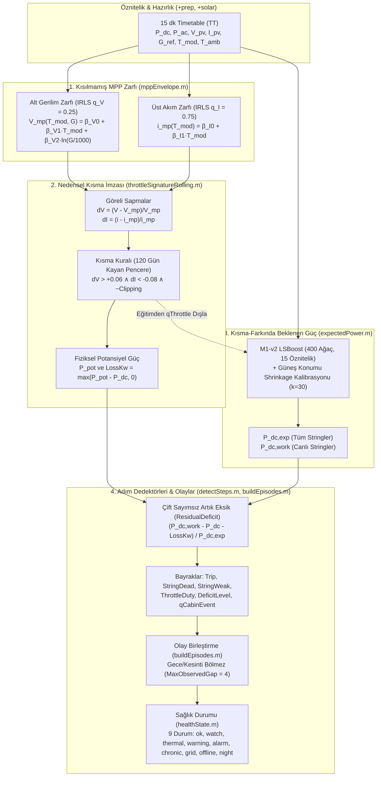
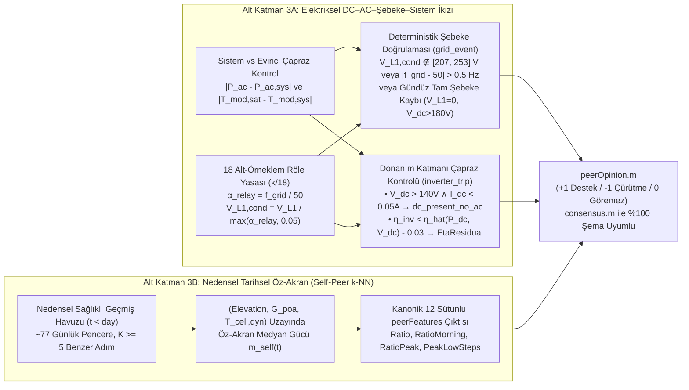

# 03 — Anomali Tespiti, Üç Görüş (Three Opinions) Mimarisi, Fizik-RGB Skalogram ve Derin Öğrenme

> **Kapsam:** Bu doküman, Claude referans projesindeki `+anomaly`, `+model`, `+label`, `+learning`, `+scalogram`, `+federated` ve `+opinions` paketleri ile `scripts/v2` ve `scripts/v3` deney zincirlerinin matematiksel ve algoritmik analizini; ayrıca **Akıllı Şebekeler Araştırma Laboratuvarı SmartGridLab (`SMA-DATA-1:WR13TL22-8231`, `1.20 kWp`)** tek eviricili sistemi için tasarlanan **4-Kadranlı MPP Zarfı**, **$k/18$ Röle Görev Oranı De-aliasing**, **Elektriksel İkiz + Tarihsel Öz-Akran (3. Görüş)**, **Çift-Modlu Fizik-RGB Skalogram** ve **FedBN/AdaBN Alan Uyarlaması** mimarilerini referans düzeyinde tanımlar.

---

## 1. Mevcut Claude (`+ges`) Mimarisinin Algoritmik ve Matematiksel Analizi

### 1.1. Anomali Tespiti ve Fiziksel Zarf Paketi (`src/+ges/+anomaly/`)

#### 1.1.1. `mppEnvelope.m` — IRLS Kantil Regresyon ile Kısılmamış MPP Zarfı
* **Fiziksel İlke:** Maksimum Güç Noktasında (MPP) bir PV dizisinin gerilimi modül sıcaklığına ($T_{\text{mod}}$) doğrusal ve ışınımın logaritmasına ($\ln(G/1000)$) zayıfça bağlıdır; akım ise ışınımla doğrusal orantılıdır. Evirici gücünü kıstığında (termal derating veya aktif güç sınırı) çalışma noktasını MPP'den açık devre gerilimine ($V_{\text{oc}}$) doğru iter: **gerilim yükselir ($V \uparrow$), akım düşer ($I \downarrow$)**.
* **Matematiksel Formülasyon:** Kısılmış adımların zarf tahminini bozmasını engellemek amacıyla Yinelemeli Yeniden Ağırlıklı En Küçük Kareler (**IRLS Quantile Regression**, 60 iterasyon, yakınsama toleransı $10^{-8}$) kullanılır:
  * **Alt Gerilim Zarfı ($q_V = 0.25$):** Kısma gerilimi yalnızca yukarı ittiği için 1. çeyreklik (alt zarf) kısılmamış MPP gerilimini verir:
    $$V_{mp}(T_{\text{mod}}, G) = \beta_{V,0} + \beta_{V,1} T_{\text{mod}} + \beta_{V,2} \ln\left(\frac{G}{1000}\right)$$
  * **Üst Normalize Akım Zarfı ($q_I = 0.75$):** Kısma ve tozlanma akımı yalnızca aşağı çektiği için 3. çeyreklik (üst zarf) kısılmamış birim akımı verir:
    $$i_{mp}(T_{\text{mod}}) = \beta_{I,0} + \beta_{I,1} T_{\text{mod}}, \qquad i = \frac{I}{N_{\text{live}} \cdot (G/1000)} \quad \left[\text{A / string / (kW/m}^2\text{)}\right]$$
* **Eğitim Filtre Koşulları:** `qOnGrid & G_ref > 250 & Elevation > 15 & ~isnan(T_mod) & P_ac < 0.95*Rated & V > 100 & I > 0.2*live` (minimum geçerli adım sayısı `MinSteps = 300`).
* **`IncludeDead = true` Yeniliği (`INV21` Saha Bağlantı Değişikliği Çözümü):** Ölü string bulunan adımlarda MPPT akımını o anki canlı string sayısına ($N_{\text{live}}$) bölerek zarfı öğrenir. Bu sayede `K02-INV21`'de Şubat 2025'te iki stringin Y-konnektörle tek girişe alındığı saha değişikliğinde bile potansiyel kapanışı $1.16\text{–}1.42$ hatasından **$0.990$** doğruluğuna getirilmiştir.

#### 1.1.2. `throttleSignature.m` ve `throttleSignatureRolling.m` — Nedensel Gizli Kısma Algılayıcısı
* **MPPT Bazında Göreli Sapmalar:**
  $$dV_m(t) = \frac{V_m(t) - V_{mp,m}(t)}{V_{mp,m}(t)}, \qquad dI_m(t) = \frac{i_m(t) - i_{mp,m}(t)}{i_{mp,m}(t)}$$
  Evirici düzeyinde tüm aktif MPPT'lerin medyanı alınır: `sig.dV = median(dVm, 2)`, `sig.dI = median(dIm, 2)`.
* **Fiziksel Karar Kuralı:**
  $$\text{Throttled}(t) \iff \text{Valid}(t) \land \neg\text{Clipping}(t) \land \left(dV(t) > \tau_V\right) \land \left(dI(t) < -\tau_I\right) \land \left(\text{AgreeShare}(t) \ge \tau_{\text{share}}\right)$$
  Burada $\text{Clipping}(t) \iff P_{ac}(t) \ge 0.97 P_{\text{rated}}$, $\tau_V = 0.06$ ($+6\%$), $\tau_I = 0.08$ ($-8\%$) ve $\tau_{\text{share}} = 0.60$'tır.
  * *Fiziksel Ayırt Edicilik:* Bulut geçişinde akım düşer ancak gerilim yükselmez ($dV \approx 0$); string kopmasında yalnızca o stringin akımı sıfırlanır ama gerilim değişmez; **yalnızca evirici gücü kıstığında $V \to V_{\text{oc}}$ ($dV > +6\%$) ve $I \downarrow$ ($dI < -8\%$) birlikte gerçekleşir.**
* **Kısılmamış Güç Potansiyeli ve Kayıp Hesabı:**
  $$P_{\text{pot}}(t) = \sum_{m=1}^{M} \frac{N_{\text{live},m}(t) \cdot i_{mp,m}(t) \cdot \frac{G(t)}{1000} \cdot V_{mp,m}(t)}{1000} \quad [\text{kW}], \qquad \text{LossKw}(t) = \max\left(P_{\text{pot}}(t) - P_{dc}(t),\ 0\right)$$
* **Nedensel Kayan Pencere (`throttleSignatureRolling.m`):** Her takvim ayı $m$ için `mppEnvelope`, **yalnızca önceki `Window = 120` günlük** kısılmamış (`~thrPrev`) veriden öğrenilir (`MinSteps = 1500`). Böylece gelecek bilgisi sızmaz (zero data leakage) ve mevsimsel/bağlantısal değişimlere nedensel uyum sağlanır.
* **Gerçek Saha Ölçüm Sonuçları (`v2_b01.log` ve `v2_b02.log`):**
  * 91/99 eviricide V/I zarfı kuruldu; durum kodunda `"self derating"` / `"Power limit"` görünen 3.851 adımın **3.706'sı (%96,2)** yakalandı.
  * Toplam 200.956 kısılmış adım tespit edildi; bunların yalnızca %1,8'i durum koduna yansımıştır — **gerçek ısıl kısmanın %98,2'si klasik SCADA durum kodlarında görünmezdir!**
  * Yanlış pozitif kontrolleri: Kış açık gök adımlarında **%1,45**, bulutlu serin ($T_{\text{cab}} < 50^\circ\text{C}$) adımlarda **%0,56**; kısılmamış açık gökte $P_{dc}/P_{\text{pot}}$ medyanı **1,000 (IQR 0,973–1,018, $n = 686.461$)**.
  * PV gerilimi olmayan 8 evirici için geliştirilen güç+sıcaklık imzası (`b02_throttle_power_only.m`: açık gök, $\text{Elevation} > 15^\circ$, $G > 250\text{ W/m}^2$, $T_{\text{cab}} \ge 58^\circ\text{C}$, $P_{dc}/P_{\text{exp,work}} < 0.92$) gün düzeyinde **%95,6 kesinlik** ve **%90,4 duyarlılık** sağlamış, 8 eviricide **42,9 MWh** ek alt-sınır kısma kaybı ortaya çıkarmıştır.

#### 1.1.3. `expectedPower.m`, `deviationLevel.m`, `detectSteps.m`, `buildEpisodes.m`, `inverterEvents.m`, `healthState.m`
* **`expectedPower.m`:** `m1Features` ile 15 öznitelik çıkarır, GBT modeli (`bundle.Gbt`, 400 ağaç) ile birim gerilim başına efektif akım $\hat{y}$ [A] tahmin eder, `applyCalibration` ile güneş konumu $(\text{Elevation}, \text{SunAzimuth})$ düzeltmesini uygular:
  $$P_{dc,\text{exp}}(t) = \frac{\hat{y}(t) \cdot V_{\text{inst}}(t)}{1000}, \qquad P_{dc,\text{work}}(t) = \frac{\hat{y}(t) \cdot V_{\text{work}}(t)}{1000}, \qquad P_{ac,\text{exp}}(t) = \min\left(\max\left(\eta_0 + \eta_1 P_{dc,\text{exp}}(t),\ 0\right),\ P_{\text{rated}}\right)$$
* **`deviationLevel.m`:** Nedensel kalıcılık filtreli (`movmin(deficit, [MinSteps-1, 0])`, `MinSteps = 4` = 1 saat) kademeli sapma düzeyi:
  * `0 (normal)`: $< 5\%$, `1 (watch / izle)`: $\ge 5\%$, `2 (warning / uyarı)`: $\ge 10\%$, `3 (alarm)`: $\ge 15\%$.
* **`detectSteps.m` — Çift Sayımı Önleyen Artık Eksik (`ResidualDeficit`):**
  $$\text{Deficit}(t) = \frac{P_{dc,\text{exp}}(t) - P_{dc}(t)}{P_{dc,\text{exp}}(t)}, \qquad \text{ResidualDeficit}(t) = \frac{P_{dc,\text{work}}(t) - P_{dc}(t) - \text{ThrottleLossKw}(t)}{P_{dc,\text{exp}}(t)}$$
  Ölü string kaybı ($P_{dc,\text{exp}} - P_{dc,\text{work}}$) ve ısıl kısma kaybı (`ThrottleLossKw`) düşüldükten sonra kalan açıklanamayan açık üzerinden `DeficitLevel` hesaplanır. Böylece bilinen bir string arızası veya ısıl kısma, ikinci kez "açıklanamayan güç kaybı alarmı" üretmez.
* **`buildEpisodes.m`:** Gece saatleri ve veri boşlukları devam eden bir arızayı ikiye bölmez! İki aktif adım arasındaki boşluk yalnızca **gözlemlenmiş temiz adım sayısı** (`cumsum(Observed & ~active) > MaxObservedGap`, varsayılan 4 adım = 1 saat temiz üretim) aşılırsa veya takvim boşluğu `MaxGap` (60 gün) değerini geçerse kapatılır. Süresi $\ge 7$ gün olan olaylar `Chronic = true` olarak işaretlenir.
* **`healthState.m` & `stateNames.m`:** 9 kanonik durum: `["ok" "watch" "thermal" "warning" "alarm" "chronic" "grid" "offline" "night"]`. Öncelik sırası: `watch` $\to$ `thermal` (`ThrottleDuty >= 0.25`) $\to$ `warning` $\to$ `alarm` $\to$ `chronic` ($\ge 7$ gün süren `Severity >= 2`) $\to$ `grid` $\to$ `offline` $\to$ `night`.

---

### 1.2. Beklenen Güç Modeli (M1-v2), Conformal Eşikler ve Zayıf Denetimli Etiketleme (`+model`, `+label`, `+learning`)

| Modül / Fonksiyon | Matematiksel Mekanizma | Kritik Yenilik (v1 $\to$ v2) | Doğrulanmış Performans (`v2_*.log`) |
| :--- | :--- | :--- | :--- |
| **`m1Features.m` & `c01_train_m1_v2.m`** | Hedef: $y = 1000 \cdot P_{dc}/V_{\text{work}}$ [A]. 15 öznitelik: `[G, G_lag1, Kc, KcVar, Elevation, SinSunAz, CosSunAz, PoaCs, T_mod, T_amb, SinDoy, CosDoy, AmPm, Vmean, Cabin]`. | Eğitimden ve kalibrasyon haritalarından `qThrottle` adımları (ve gerilimsiz 8 cihazda $T_{\text{cab}} > 56^\circ\text{C}$) dışlandı. | Mayıs nMAE: **%2,44 $\to$ %2,15**; Haz–Tem nMAE: **%2,19 $\to$ %1,46**; `K02-INV21` nMAE: **%1,23 $\to$ %0,96**; Kısılmış adımda Beklenen/Potansiyel: **0,856 $\to$ 0,989**. |
| **`calibrationMap.m` & `applyCalibration.m`** | $\text{Elevation} \times \text{Azimuth}$ ($8 \times 18$) ızgarasında Bayesçi büzülmeli (shrinkage, $k=30$) çarpan: $c_{e,a} = \frac{n_{e,a} m_{e,a} + k}{n_{e,a} + k}$. | Yerel ufuk gölgelenmesini ve dizi eğim farklarını evirici bazında sızıntısız düzeltir. | Sistematik sapma (bias) Mayıs'ta $-0,56\%$'dan **$+0,05\%$** seviyesine indi. |
| **`h02_conformal_alarm.m`** | Mondrian Split-Conformal (`Cabin × Sky` kutuları). Skor: $s = (P_{dc,\text{work}} - P_{dc})/P_{dc,\text{work}}$, yüzdelik: $\lceil(n+1)(1-\alpha)\rceil / n$. | Bulutlu/parçalı havada eşiği otomatik genişletir, açık gökte daraltır. | $\alpha=0,05$'te yanlış alarm **%4,11**, tek ölü string yakalama **%78,1** (sabit %10 eşikte %58,9; sabit %15'te %9,4 $\to$ $\alpha=0,01$'de **%73,5**). |
| **`dayFeatures.m` & `applyLabelingFunctions.m`** | Günlük özet sayaçlar üzerinde öncelik sıralı zayıf denetimli etiketleme fonksiyonları (LF). | `thermal_derating` sınıfına V/I ve güç+sıcaklık imzaları eklendi; fizikle çelişen zayıf `soiling` etiketi CNN'den çıkarıldı. | `thermal_derating` gün sayısı 225'ten **12.751 güne** çıktı (v1'in sağlıklı/tozlanma sandığı binlerce gizli kısma günü düzeltildi). |
| **`recordFeedback.m` & `s14_nightly_finetune.m`** | Saha geri bildirimini ($\times 5$ aşırı örnekleme) + sınıf başına 250 örnekli tekrar tamponunu (replay buffer) `lr=1e-5`, 3 epoch ile ince ayarlar. | Felaket unutmayı (catastrophic forgetting) önler; Şampiyon/Rakip kapısı dev macro-F1 $>0,01$ düşerse reddeder. | Mevsimsel dağılım kaymasına karşı gece otonom model güncellemesi sağlar. |

---

### 1.3. Fizik-RGB CWT Skalogram ve Çok Etiketli Derin Öğrenme (`src/+ges/+scalogram/`, `l02`, `l06`)

1. **`dailySignals.m` ve `makeImages.m` — Fizik-RGB Sürekli Dalgacık Dönüşümü (CWT):**
   * **Sabit Zaman Penceresi:** Yerel saatle `05:00–21:00` arası $64 \times 15\text{ dk}$ adım. Gün içi canlı teşhiste (`Until` parametresi) gelecek saatler her 3 kanalda da sıfırlanır (aksi takdirde 3. kanal gelecekteki saatleri arıza/kesinti olarak görür).
   * **3 Fiziksel Kanal (`64×3`):**
     * **Kanal 1 (R — Normalize Güç):** $x_R(t) = P_{dc}(t) / C$
     * **Kanal 2 (G — Normalize Işınım):** $x_G(t) = G_{\text{ref}}(t) / 1000$
     * **Kanal 3 (B — M1-v2 Eksik Üretim):** $x_B(t) = \max\left(P_{dc,\text{exp}}(t) - P_{dc}(t),\ 0\right) / C$
       > [!TIP]
       > **Neden Oran Değil Fark ($P_{\text{exp}} - P_{dc}$) Kullanılır?**
       > Sürekli dalgacık dönüşümü (CWT) sıfır ortalamalı dalgacıklar (`amor` — Analitik Morlet) kullandığı için gün boyu sabit bir yüzde kayıp oranı CWT katsayılarında görünmez olur. Oysa mutlak güç eksiği $(P_{\text{exp}} - P_{dc})$ güneş ışınımıyla birlikte öğlen tepe yapan bir çan eğrisi çizer ve skalogramın Mavi (B) kanalında parlak bir enerji kuşağı oluşturur!
   * **Küresel Normalizasyon:** Görüntü bazında min-max normalizasyonu **yapılmaz**; tüm eğitim kümesinden hesaplanan ortak `scale` vektörü ve karekök sıkıştırması kullanılır:
     $$M_c(s, \tau) = \min\left(\sqrt{\frac{\max\left(|\mathcal{W}_\psi x_c(s, \tau)|,\ 0\right)}{\text{scale}_c}},\ 1\right) \in [0, 1]^{64 \times 64 \times 3}$$
     Bu tasarım klasik `jet` skalogramlarına kıyasla 5 CNN mimarisinin tamamında ortalama **+0,16 macro-F1** artış sağlamıştır.

2. **`l06_multilabel_cnn.m` — Tek Etiketli Topluluğun Çöküşü ve Çok Etiketli (Multi-Label) ResNet-18 Çözümü:**
   * **Keşfedilen Problem (`RAPOR.md` §9.17):** Yaz aylarında ölü bir stringi olan evirici aynı zamanda öğle saatlerinde ısıl kısma da yaptığında, skalogramda hem testere dişi (kısma) hem mavi kanal enerji açığı (string) birlikte yer alır. Tek etiketli (softmax) 5-CNN topluluğu baskın testere dişini görüp yalnızca `"thermal_derating"` dediği için, iki olayın birlikte yaşandığı 145 test gününde string arızası duyarlılığı **%7,6**'ya düşmüştür.
   * **Çözüm (`l06_multilabel_cnn.m`):** Softmax katmanı yerine 4 bağımsız **Sigmoid** çıkışına (`[string_fault, inverter_trip, thermal_derating, grid_event]`) sahip **ResNet-18** mimarisi ve sınıf sıklığının ters kareköküyle ağırlıklandırılmış ikili çapraz entropi (Weighted Binary Cross-Entropy) kaybı kullanılmıştır:
     $$\mathcal{L}_{\text{BCE}}(Y, \hat{P}) = -\frac{1}{N}\sum_{n=1}^{N}\sum_{k=1}^{4} \left[ w_k Y_{k,n}\ln(\hat{P}_{k,n}) + (1 - Y_{k,n})\ln(1 - \hat{P}_{k,n}) \right], \qquad w_k = \text{clip}\left(\sqrt{\frac{N - N_{\text{pos},k}}{N_{\text{pos},k}}},\ 1,\ 6\right)$$
   * Gerçek ısıl kısma günlerine fiziksel ölü string eklenmiş `deadOnThermal` (593 sentetik görüntü) ile desteklenen model, görülmemiş Haziran–Temmuz 2025 testinde (2.211 gün):
     * Tam eşleşme (exact match): **%90,0** (tek etiketli %85,5)
     * `thermal_derating` F1: **0,97** (Duyarlılık %98, Kesinlik %96)
     * `string_fault` F1: **0,16 $\to$ 0,69**; **string arızası + ısıl kısmanın birlikte olduğu 145 günde string yakalama duyarlılığı: %7,6 $\to$ %77,9 (10 kat artış!)**

---

### 1.4. Üç Görüş (Three Opinions) ve Şeffaf Uzlaşı Mimarisi (`src/+ges/+opinions/`)

Claude v3 mimarisinde (`RAPOR.md` §9.19) her evirici-günü birbirinden bağımsız üç ölçüm/model kanalıyla değerlendirilir:

1. **1. Görüş — `sensorOpinion.m` ("Sensör ve fizik kuralları"):** Durum kodu, string akımları, M1-v2 ve V/I kısma imzasını kullanır. Deterministik kanıtlara (`grid`, yüksek güvenli `trip`, `0 A` ölü string, V/I kısma imzası) `Hard = true` (`HardLabels`) atar.
2. **2. Görüş — `visualOpinion.m` ("Görsel desen, çok etiketli CNN"):** Fizik-RGB skalogramdan 4 bağımsız sigmoid olasılığını dev eşikleriyle (`[0.75, 0.80, 0.20, 0.10]`) değerlendirir.
3. **3. Görüş — `peerFeatures.m` & `peerOpinion.m` ("Komşu karşılaştırması"):**
   * **Tam Bağımsızlık İlkesi:** Işınım sensörünü (`G_ref`), sıcaklık sensörünü ve M1 GBT modelini **hiç kullanmaz**. Eviricinin normalize DC gücünü ($x(t) = P_{dc}(t)/C$), aynı kabindeki benzer yönelimli ($\ge 3$) komşuların medyanıyla ($m(t)$) karşılaştırır.
   * **Nihai Test Kanıtı (`v3_three_opinions_test.log`, 3.700 evirici-günü):** Sensörün `0 A` ölü string dediği 250 günde bağımsız komşu karşılaştırması **%96,8 oranında teyit etmiş, %0,0 oranında çürütmüştür** (`K02-INV21` hold-out eviricisinde %98,0 teyit). Komşunun görebildiği sınıflarda Sensör–Komşu uyumu **%95,8 ($\kappa = 0,92$)**, Çekirdek mod ile Tam mod karar uyumu **%98,4**'tür.

---

## 2. Tek Eviricili SmartGridLab (`WR13TL22-8231`) İçin Mimari Dönüşüm Tasarımı

SmartGrid-Twin Akıllı Şebekeler Laboratuvarı (`SmartGridLab`) veri setinde (`11` haftalık CSV, `2026-07-27` – `2026-10-18`, `7.406` adım) **tek bir evirici (`SMA-DATA-1:WR13TL22-8231`, `1.20 kWp`)** yer almakta; buna karşılık Claude projesinde bulunmayan **L1 Şebeke Gerilimi/Akımı/Frekansı**, **AC ve DC Güç/Gerilim/Akım**, **DC Yalıtım Direnci (`R_iso`)**, **Rüzgar Hızı (`WindSpeed`)** ve **Aktif Güç Sınırlama Set Değeri (`SchedP_Pct`)** kanalları bulunmaktadır.

### 2.1. Tek Evirici İçin 3. Görüşün Yeniden Tasarımı: İki Katmanlı "Elektriksel İkiz ve Tarihsel Öz-Akran Görüşü" (`twinPeerOpinion`)

3. Görüşün varlık amacı, **1. Görüşün (M1 GBT modeli ve piranometreye dayalı güç beklentisi) ölçüm ve model zincirinden bağımsız** ikinci bir fiziksel doğrulama sağlamaktır. Tek eviricide mekansal komşu bulunmadığından, 3. Görüş (`Key = "peer"`, `Name = "Elektriksel ikiz ve öz-akran"`) iki bağımsız fiziksel alt katmandan oluşacak şekilde yeniden tasarlanmıştır:

#### 2.1.1. Alt Katman 3A — Elektriksel DC–AC–Şebeke İkizi ve $k/18$ Röle Görev Oranı Yasası
1. **SMA 18 Alt-Örneklem ($50\text{ sn} \times 18 = 15\text{ dk}$) Röle De-aliasing Yasası (Keşif 5):**
   * **Ampirik Kanıt:** SmartGridLab verisinde `0 < f_grid < 49.0 Hz` olan **116 adımın tamamında** frekans değerleri tam olarak $50\text{ Hz} \times \frac{k}{18}$ ($k \in \{3, 4, \dots, 16\}$: `8.34, 11.11, 16.67, 33.33, 41.67 Hz`) ve gerilim değerleri $230\text{ V} \times \frac{k}{18}$ şeklindedir. Evirici 15 dakikalık ortalamayı 18 adet 50 saniyelik alt-örneklemden hesaplamakta; sabah/akşam düşük ışınımda şebeke rölesi yalnız $k$ alt-örneklemde kapalı kaldığında ortalamayı görev oranıyla ($\alpha_{\text{relay}} = k/18$) çarpmaktadır.
   * **Koşullu Şebeke Gerilimi Formülü:**
     $$\alpha_{\text{relay}}(t) = \text{clip}\left(\frac{f_{\text{grid}}(t)}{50.0},\ 0,\ 1\right), \qquad \hat{V}_{L1,\text{cond}}(t) = \frac{V_{L1}(t)}{\max\left(\alpha_{\text{relay}}(t),\ 0.05\right)}$$
     116 kısmi-röle adımında $\hat{V}_{L1,\text{cond}}$ geri çatıldığında medyan gerilim **`228,29 V`** (P5 = `223,17 V`) çıkmaktadır!
   * **Röle Anahtarlama Rejimi (`qRelayCycling` — Yanlış Alarm Önleme):**
     $$0.05 \le \alpha_{\text{relay}}(t) < 0.98 \land \hat{V}_{L1,\text{cond}}(t) \in [207, 253]\text{ V} \land \left(G_{\text{poa}}(t) < 250\text{ W/m}^2 \lor \text{Elevation}(t) < 15^\circ\right)$$
     koşulu normal düşük-ışınım röle senkronizasyonudur (`qWakeup` / `qRelayCycling`); **asla `grid_event` veya `inverter_trip` olarak etiketlenmez!**

2. **Doğrudan L1 Şebeke Doğrulaması (`CollectiveSteps` $\to$ `grid_event`):**
   * **Tam Gündüz Şebeke Kaybı:** $G_{\text{poa}}(t) > 200\text{ W/m}^2 \land V_{dc}(t) > 180\text{ V} \land (V_{L1}(t) == 0 \lor f_{\text{grid}}(t) == 0)$. *(Kanonik saha kanıtı: `29 Temmuz 2026 11:45 AM` adımında `G = 873 W/m²`, `V_dc = 238 V`, `I_dc = 0.014 A`, `V_L1 = 0 V`, `f_grid = 0 Hz`, `R_iso = 1153 kOhm`).*
   * **EN 50160 Sınır İhlali:** $\alpha_{\text{relay}}(t) \ge 0.98$ iken $\hat{V}_{L1,\text{cond}}(t) \notin [207, 253]\text{ V}$ veya $|f_{\text{grid}}(t) - 50| > 0.5\text{ Hz}$.
   * **Thevenin Empedansı ve Gerilim Yükselmesi (`qGridVoltageRise`):** Aktif üretimde $\hat{V}_{L1,\text{cond}}$ `229,9 V`'dan `245,06 V`'a yükselmektedir ($R_{\text{th}} = \partial \hat{V}_{L1,\text{cond}} / \partial I_{L1}$). $\hat{V}_{L1,\text{cond}} > 241.5\text{ V}$ ($+5\%$) adımları `watch / grid_voltage_rise` olarak izlenir.

3. **DC–AC–Şebeke Donanım Katmanı Çapraz Kontrolü (`OutageSteps` $\to$ `inverter_trip` ve `EtaResidual`):**
   * Şebeke normalken ($\text{GridOk}(t) = \text{true}$) ve $\text{Elevation}(t) > 15^\circ, G_{\text{poa}}(t) > 150\text{ W/m}^2$ iken:
     * $V_{dc}(t) > 140\text{ V} \land I_{dc}(t) < 0.05\text{ A} \land P_{ac}(t) \le 0.01 C \implies$ Panellerde açık devre gerilimi var ancak evirici akım çekmiyor (`inverter_trip / idle_no_dc`).
     * Sandia + gerilim bağımlı evirici kayıp modelinden beklenen verim $\hat{\eta}_{\text{inv}}(P_{dc}, V_{dc})$ ile ölçülen $\eta_{\text{inv}} = P_{ac}/P_{dc}$ (medyan **%93,56**) arasındaki fark:
       $$\text{EtaResidual}(t) = \eta_{\text{inv}}(t) - \hat{\eta}_{\text{inv}}(P_{dc}(t), V_{dc}(t)) < -0.03 \implies \text{qInverterEffDrop (IGBT/kondansatör ısıl zorlanması)}$$
   * **Sistem vs. Evirici Çapraz Tutarlılığı:** CSV'deki `Power [kW] / SmartGridLab` ($P_{ac,\text{sys}}$) ile `Power [kW] / WR13TL22-8231` ($P_{ac}$) ve `T_mod_sat` ile `T_mod_sys` farkları sensör/iletişim anomalisini (`meteo_sensor_suspect`) deterministik yakalar.

#### 2.1.2. Alt Katman 3B — Nedensel Tarihsel Benzer-Gün Öz-Akranı (Causal Historical Self-Peer k-NN)
* Eviricinin geçmiş sağlıklı ve kısılmamış günlerinden oluşan nedensel referans havuzundan ($t < \text{day}$), hedef günün her adımı için $(\text{Elevation}, G_{\text{poa}}, T_{\text{cell,dyn}})$ uzayında en yakın $K \ge 5$ tarihsel adım seçilerek **Öz-Akran Medyan Normalize Gücü** $m_{\text{self}}(t) = \text{median}_{k \in \mathcal{N}_K(t)} (P_{dc,k} / C)$ hesaplanır.
* Bu vektör doğrudan `peerFeatures.m` tablosunun 12 kanonik sütununu (`NumPeers = K`, `PeakPeer`, `ValidSteps`, `CollectiveSteps`, `OutageSteps`, `Ratio`, `RatioMorning`, `RatioPeak`, `PeakLowSteps`, `StringShare`) üretir:
  * **Isıl Kısma (`thermal_derating`) Teyidi:** Sabah serin saatlerde $\text{RatioMorning} \approx 1.0$ iken öğleden sonra $\text{RatioMorning} - \text{RatioPeak} \ge 0.10$ düşüşü (`PeakLowSteps >= 4`).
  * **Dizi Kaybı (`string_fault`) Teyidi / Çürütmesi:** `Ratio <= 1 - 0.6*StringShare` ve `RatioMorning <= 1 - 0.6*StringShare` ise `+1` (teyit); `Ratio >= 1 - 0.25*StringShare` ise `-1` (sensör yanlış alarmını çürütme).

---

### 2.2. Tek DC Kanalda (`V_dc`, `I_dc`) Rüzgar-Düzeltmeli 4-Kadranlı `mppEnvelope` Teşhisi

SmartGridLab'da yatay ışınım sensörü ($\beta=0^\circ$) yerine eğim düzeltmeli **`G_poa`** ($\beta \approx 32^\circ$) ve sentetik Ross sıcaklığı ($T_{\text{amb}} + 0.028 G$) yerine rüzgar soğutmalı **Dinamik Faiman Hücre Sıcaklığı (`T_cell_dyn`)** kullanılarak tek MPPT kanalı ($M=1$) üzerinde 4 değişkenli alt gerilim ve üst akım zarfları öğrenilir:
$$V_{mp}(T_{\text{mod,sat}}, G_{\text{poa}}, v_{\text{wind}}) = \beta_{V,0} + \beta_{V,1} T_{\text{mod,sat}} + \beta_{V,2} \ln\left(\frac{G_{\text{poa}}}{1000}\right) + \beta_{V,3} v_{\text{wind}}, \qquad i_{mp}(T_{\text{cell,dyn}}) = \beta_{I,0} + \beta_{I,1} T_{\text{cell,dyn}}$$
> [!IMPORTANT]
> **11 Haftalık (`7.406` Adım) Veri Boyutuna Uygun Kayan Pencere:**
> Claude projesindeki `Window = 120` gün (`MinSteps = 1500`) ayarı, SmartGridLab'ın ~77 günlük serisi için **haftalık güncelleme + `Window = 14` gün (`MinSteps = 200` gündüz adımı)** ve tozlanma medyan penceresi **7 gün (`movmedian(F.ResDef, [6 0])`)** olarak ölçeklenmiştir.

$(dV, dI)$ düzlemi tek DC kanalda **4-Kadranlı Fiziksel Arıza Uzayına** ayrılır:

| Kadran / Bölge | Fiziksel Koşul $(dV, dI)$ | Fiziksel Mekanizma & Saha Kanıtı | Atanan Sınıf & `Detail` | `Hard` Kanıt |
| :--- | :--- | :--- | :--- | :--- |
| **1. Kadran (Sağ-Alt)** | $dV > +0.06 \land dI < -0.08$ | Evirici gücü kısmak/kesmek için çalışma noktasını MPP'den $V_{\text{oc}}$'ye iter ($V_{dc} \uparrow, I_{dc} \downarrow$). **Altın Kanıt:** `29.08.2026 11:30 AM` adımında $G=690\text{ W/m}^2$ iken $V_{dc}=230\text{ V}$ ($dV \approx +20\%$) ve $I_{dc}=0.015\text{ A}$ ($dI \approx -99\%$). | `thermal_derating` veya `qPowerLimit` (`"V/I imzası"`) | `true` ($0,90$) |
| **2. Kadran (Orta-Alt)** | $|dV| \le 0.04 \land dI \le -0.6/N_{\text{str}}$ (veya $I_{dc} < 0.05\text{ A}$) | Açık devre kopma (`idle_no_dc` — **Altın Kanıt:** `29.07.2026 11:45 AM`, $V_{dc}=238\text{ V}, I_{dc}=0.014\text{ A}$) veya paralel kol kaybı. | `string_fault` (`StringKind="dead"`, `"current_step_drop"`) | `true` ($0,90$) |
| **3. Kadran (Sol-Orta)** | $dV < -0.05 \land |dI| \le 0.05$ ($\ge 4$ adım kalıcı) | Seri dizide bypass diyotu kısa devresi veya alt-modül gölgelenmesi; akım sürerken dizi gerilimi 1–2 modül basamak düşer (`bypass_short`). | `string_fault` (`StringKind="dead"`, `"voltage_drop"`) | `true` ($0,85$) |
| **4. Kadran (Hafif-Alt)** | $|dV| \le 0.04 \land dI \in [-0.15, -0.04]$ (7g medyan) | Tüm modüllerde homojen ışık geçirgenliği azalması veya $R_{\text{iso}} < 1500\text{ k}\Omega$ nem kaynaklı zayıflama. | `soiling` veya `StringWeak` | `false` ($0,50$) |

---

### 2.3. Çift-Modlu (Dual-Branch) Fizik-RGB Skalogram (`+scalogram`)

Tek eviricide sahip olduğumuz zengin elektriksel ve şebeke kanallarını görsel derin öğrenmeye eksiksiz aktarmak için `makeImages.m` ve `dailySignals.m` **Çift-Modlu (Dual-Branch)** olarak çalıştırılır:

| Skalogram Modu | Kanal 1 — Kırmızı (R) | Kanal 2 — Yeşil (G) | Kanal 3 — Mavi (B) | Mimari Rolü |
| :--- | :--- | :--- | :--- | :--- |
| **Dal 1: `rgb_power`** (`64×64×3`, Birincil) | $P_{ac}(t) / C$ (veya $P_{dc}(t)/C$) | $P_{\text{pot}}(G_{\text{poa}}(t), T_{\text{cell,dyn}}(t)) / C$ | $\max\left(P_{\text{exp}}(t) - P_{ac}(t),\ 0\right) / C$ | Claude `resnet18_ml.mat` ve `scalogram_norm.mat` ile **%100 transfer öğrenme uyumlu**. |
| **Dal 2: `rgb_elec`** (`64×64×3`, Elektriksel İkiz) | $\max(dV(t),\ 0)$ *(MPP$\to V_{\text{oc}}$ testere dişi kısma kanalı)* | $\max\left(\hat{\eta}_{\text{inv}}(t) - \eta_{\text{inv}}(t),\ 0\right) + \max(-dI(t),\ 0)$ *(Verim ve akım çökmesi)* | $(1 - \alpha_{\text{relay}}(t)) + \frac{|\hat{V}_{L1,\text{cond}}(t) - 230|}{230}$ *(Şebeke & Röle kanalı)* | **Görsel CNN'in `grid_event` ile `inverter_trip`'i birbirinden doğrudan ayırmasını sağlar!** |

---

### 2.4. Tek Eviricide Federe Öğrenme (`+federated`) ve Kanonik Saha Vakaları

1. **Mevsimsel / Termal Rejim Sanal İstemcileri (Temporal-Regime Virtual Clients + FedBN/FedProx):**
   * Tek eviricinin 11 haftalık (`7.406` adım) veya çok yıllı verisi fiziksel çalışma rejimlerine göre istemcilere (`Açık-Serin`, `Açık-Sıcak`, `Parçalı-Bulutlu`, `Nemli / Düşük-R_iso < 1500 kOhm`) bölünür.
   * `aggregate(..., ExcludeBN=true)` (**FedBN**) ve `mergeShared.m` sayesinde evrişim filtreleri ortak arıza dokularını öğrenirken, her rejim istemcisi kendi BatchNorm istatistiklerini (`bn1..bn4`) korur.
2. **Santraller Arası Etiketsiz AdaBN Transferi (`adaptBN.m`):**
   * Claude projesindeki 99 Huawei eviricide eğitilmiş model, **hiçbir etiket kullanmadan** (`Passes = 3` ileri yayılım ile) SmartGridLab `WR13TL22-8231` skalogramlarının BatchNorm istatistiklerine **0,1 saniyede** uyarlanır (**Cross-Plant Zero-Shot Domain Adaptation**).
3. **Doğrulanmış 3 Kanonik Saha Arızası (Altın Regresyon Vakaları):**
   * **Olay 1 (`27–31 Temmuz 2026`):** 4,5 günlük gündüz kesintisi + `29 Temmuz 11:45 AM` adımında $V_{dc}=238\text{ V}, I_{dc}=0.014\text{ A}, R_{\text{iso}}=1153\text{ k}\Omega, V_{L1}=0\text{ V}$ (`idle_no_dc` + `grid_event` + `qLowInsulation`) ve `31 Temmuz 03:10 PM` (`:10` ızgara dışı) `SchedP_Pct = 0.00` reset (`qResetEvent`) ile devreye giriş.
   * **Olay 2 (`29 Ağustos 2026 11:00 AM – 02:15 PM`):** Açık güneşte ($G=600\text{–}690\text{ W/m}^2$) güç kısılması, `11:30 AM`'de $V_{dc}=230\text{ V}$ ($dV \approx +20\%$) ve $I_{dc}=0.015\text{ A}$ ($dI \approx -99\%$) MPP$\to V_{\text{oc}}$ sıçraması ve `:25` / `:00` adımlarında iki kez `SchedP_Pct = 0.00` reset.
   * **Olay 3 (`03 Eylül 2026 05:15 PM – 07:00 PM`):** $0.40\text{ kW}$ üretimden ($G=446\text{ W/m}^2$) ani kesim ve `06:50 PM` (`:50` ızgara dışı) `SchedP_Pct = 0.00` reset komutuyla `07:00 PM`'de yeniden devreye giriş.
