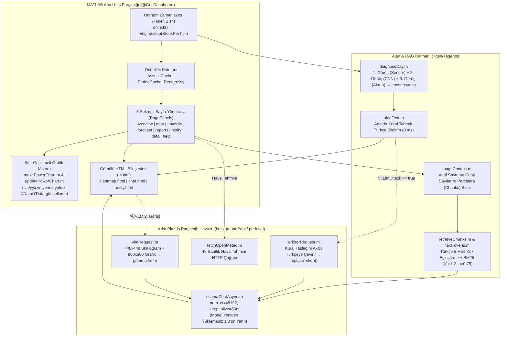
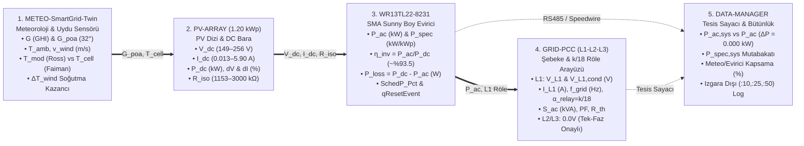

# 04 — Dashboard UI (`@GesDashboard`), Web Harita/Sohbet, LLM/VLM Ajan ve Test Mimarisi

> **Kapsam:** Bu doküman, Claude referans projesindeki `@GesDashboard` (MATLAB App Designer / `uifigure`), `app/web` (`plantmap.html`, `chat.html`, `notify.html`), `src/+ges/+agents/`, `src/+ges/+llm/` ve `tests/` katmanlarının satır bazlı teknik analizini; ayrıca **SmartGrid-Twin Akıllı Şebekeler Laboratuvarı (`SmartGridLab — SMA-DATA-1:WR13TL22-8231`, `1.20 kWp`)** için tasarlanan **5 Düğümlü İnteraktif Topoloji Haritası**, **4 Modlu Mühendislik Grafikleri**, **Sıfır Halüsinasyonlu BM25 Sayfa Asistanı (`PageChat`)** ve **Regresyon Test Altyapısını** tanımlar.

---

## 1. Mevcut Claude Arayüz, Ajan ve Test Mimarisinin Analizi

### 1.1. `@GesDashboard` Sınıf Mimarisi ve Asenkron İş Parçacığı Yönetimi (`app/@GesDashboard/`)

#### 1.1.1. Performans ve Arayüz Yanıt Süresi Optimizasyonları (`GesDashboard.m`)
1. **UI İş Parçacığı Kilitlenmesinin Önlenmesi (`backgroundPool`):**
   * İlk sürümde senkron çalışan LLM/VLM ve internet çağrıları arayüzü ~25 saniye kilitliyordu. Tüm ağır çağrılar `ges.llm.ollamaChatAsync` (`parfeval` + `afterEach`) ile arka plana alınmıştır.
   * Yeni bir alarm oluştuğunda `ges.agents.alertText` ile **anında (0 ms)** kural tabanlı şablon bildirim (`notify.html`) düşer ve geçici bir `token` atanır; arka planda `arbiterRequest` tamamlandığında (~1,3 sn) `replaceToken` ile kart metni güncellenir.
2. **Grafik Nesnesi Yeniden Kullanımı (`makePowerChart.m` & `updatePowerChart.m`):**
   * MATLAB'da her tikte `cla(ax)` ve `yyaxis(ax, "left"/"right")` çağırmak ~1–2 saniye sürer. Bunun yerine eksen ve çizgi nesneleri (`PdcLine`, `PacLine`, `PexpLine`, `IrrArea`, `NowLine`) yalnızca bir kez oluşturulur (`ax.UserData.Chart`); her adımda yalnız `XData` ve `YData` vektörleri güncellenerek oynatma tiki **0,01–0,15 saniyeye** indirilmiştir.
3. **Ollama Bağlam Sabitlemesi (`ollamaChat.m`):**
   * Ollama, `num_ctx` her değiştiğinde modeli GPU/CPU belleğinden boşaltıp yeniden yükler (23,5 sn gecikme). Tüm çağrılarda `num_ctx = 8192` ve `keep_alive = "60m"` sabit tutularak sıcak çağrı süresi **1,3 saniyeye** düşürülmüştür.
4. **JavaScript `NaN` Koruması (`plantmap.html`):**
   * MATLAB `uihtml`, `NaN` değerini JavaScript'e sayı değil `"NaN"` metni olarak iletir. `plantmap.html` içinde her kutucuk bağımsız güncellenir ve sayısal olmayan değerler güvenli biçimde `"offline"` (`Veri yok`) durumuna atanır.

---

### 1.2. Sayfa-Kapsamlı RAG Asistanı (`PageChat.m`, `retrieveChunks.m`, `textTokens.m`)

Araç çağıran (tool-calling) küçük dil modellerinin parametre/fonksiyon uydurma riskine karşı Claude v3'te **Araçsız, Sayfa-Kapsamlı Deterministik RAG (`PageChat`)** mimarisi geliştirilmiştir:
* **`pageContext.m`:** Kullanıcının o an açık olan sekmede (`overview`, `map`, `analysis`, `forecast`, `reports`, `notify`, `data`, `help`) gördüğü tüm KPI, tablo ve teşhis verilerini `(Title, Text)` yapısında metin parçalarına (`Chunks`) dönüştürür.
* **`textTokens.m` (Türkçe Kök Eşleştirme):** Türkçe karakterleri ASCII karşılıklarına katlar (`ı->i, ş->s, ğ->g, ü->u, ö->o, ç->c`), cihaz kimliklerini korur ve kelimeleri **ilk 5 harfine** indirgeyerek (`"invertörün" -> "inver"`, `"kısması" -> "kisma"`) eklerden bağımsız eşleşme sağlar.
* **`retrieveChunks.m` (BM25 Sıralaması):** Okapi BM25 ($k_1 = 1.2, b = 0.75$) algoritmasıyla soruya en uygun `TopK = 4` parçayı seçer; ilk parça (sayfa özeti) her zaman bağlama eklenir:
  $$\text{BM25}(Q, d) = \sum_{q \in Q} \text{IDF}(q) \cdot \frac{\text{tf}(q, d) \cdot (k_1 + 1)}{\text{tf}(q, d) + k_1 \cdot \left(1 - b + b \cdot \frac{|d|}{\text{avgdl}}\right)}, \qquad \text{IDF}(q) = \ln\left(1 + \frac{N - df(q) + 0.5}{df(q) + 0.5}\right)$$
* **Sayfa Yönlendirme (`Hint` ve `[[git:<Sayfa>]]`) ve Hafıza (`📌 Hafızaya al`):** Soru başka bir sayfanın `PageTopics` diziniyle aktif sayfadan $1.2\times$ daha yüksek BM25 skoruyla eşleşirse, LLM yanıtının sonuna `[[git:<Sayfa>]]` etiketi eklenir ve `chat.html` içinde tıklanabilir **`→ <Sayfa> sayfasına git`** düğmesi oluşur. Kullanıcının `📌 Hafızaya al` ile kaydettiği özetler `Memory` dizisinde tutularak sayfalar arası karşılaştırma yapılmasını sağlar.

---

## 2. SmartGrid-Twin (`WR13TL22-8231`) Arayüz, Harita ve Asistan Dönüşüm Tasarımı

### 2.1. Kanonik Cihaz Kimliği ve `ReplayEngine.series()` Veri Sözleşmesi
Ajan 1, Ajan 3 ve Ajan 4 arasındaki mimari bütünlüğü korumak üzere:
* **Kanonik Kimlik:** Geriye dönük düzenli ifadeler (`k\d{2}-inv\d{2}`) ve testlerle %100 uyumluluk için `Id = "K01-INV01"`, `Cabin = 1`, `Inv = 1` olarak tutulur; yanında `info.Device = "SMA-DATA-1:WR13TL22-8231"` ve `info.DisplayName = "WR13TL22-8231 (1.20 kWp)"` taşınır.
* **`ReplayEngine.series(id, t0, t1)` Ortak Sütun Sözleşmesi:**
  `Pact` ($P_{dc}$, kW), `Pexp` (kW), `Pac` ($P_{ac}$, kW), `PacSpec` (kW/kWp), `Eff` ($\eta_{\text{inv}}$ %), `Vdc` (V), `Idc` (A), `Vgrid` ($V_{L1}$, V), `VgridCond` ($\hat{V}_{L1,\text{cond}}$, V), `Igrid` ($I_{L1}$, A), `Fgrid` ($f_{\text{grid}}$, Hz), `AlphaRelay` ($\alpha_{\text{relay}} = k/18$), `PgridApp` ($S_{ac}$, kVA), `PF`, `Riso` (k$\Omega$), `G` ($\text{W/m}^2$), `Gpoa` ($\text{W/m}^2$), `Tmod` ($^\circ\text{C}$), `Tcell` ($T_{\text{cell,dyn}}$, $^\circ\text{C}$), `Tamb` ($^\circ\text{C}$), `DeltaT` ($T_{\text{mod}} - T_{\text{amb}}$, $^\circ\text{C}$), `Wind` (m/s), `SchedP` (%).

---

### 2.2. `app/web/plantmap.html` — 5 Düğümlü İnteraktif Laboratuvar Topoloji Haritası (%100 Sütun Kapsaması)

99 kutucuklu kabin ızgarası yerine `plantmap.html`, **SmartGrid-Twin Akıllı Şebekeler Laboratuvarı İnteraktif Dijital İkiz Topolojisi (Interactive SVG Power Flow + 5 Tıklanabilir Düğüm)** olarak tasarlanmıştır:

* **Tıklanabilir Düğüm Etkileşimi (`sendEventToMATLAB("nodeClicked", {node: nodeId})`):** Kullanıcı 5 düğümden hangisine tıklarsa, sağ paneldeki detay kartı ve altındaki grafik otomatik olarak o düğümün mühendislik görünümüne (ör. `GRID-PCC` tıklandığında L1 Gerilim/Frekans ve $k/18$ röle grafiğine; `PV-ARRAY` tıklandığında $V_{dc}, I_{dc}$ ve $R_{\text{iso}}$ grafiğine) geçer!

---

### 2.3. `@GesDashboard` Sekmelerinin ve Mühendislik Grafiklerinin Dönüşümü

#### A) `buildOverview.m` & `renderOverview.m` ve `private/energyText.m`
1. **Mikro-Şebeke Birim Ölçekleme (`energyText.m`):** `1.20 kWp` tek evirici (günlük ~5–9 kWh üretim) için: `< 1 kWh` ise `%.0f Wh`, `1–1000 kWh` arası `%.2f kWh`, `>= 1000 kWh` ise `%.2f MWh`. Güç gösterimleri `%.2f kW` (`%.0f W`) duyarlılığına yükseltilir.
2. **6 KPI Kartı:**
   * **Kart 1 (`Power`):** Anlık `P_ac` (kW), `P_dc` (kW), Beklenen `P_exp` (kW) ve **Evirici Verimi ($\eta_{\text{inv}} = P_{ac}/P_{dc}$ %)**.
   * **Kart 2 (`Today`):** Bugünkü Enerji (`kWh`), Performans (`%`) ve Özgül Güç (`kWh/kWp`).
   * **Kart 3 (`DcBus`):** DC Gerilim (`V_dc`), DC Akım (`I_dc`) ve **Yalıtım Direnci (`R_iso` [k$\Omega$])** nem/çiğ rozeti.
   * **Kart 4 (`GridL1`):** Koşullu L1 Gerilimi ($\hat{V}_{L1,\text{cond}}$ [V]), Ham $V_{L1}$ [V], $I_{L1}$ [A], $f_{\text{grid}}$ [Hz], Röle Görev Oranı ($\alpha_{\text{relay}} = k/18$) ve EN 50160 rozeti.
   * **Kart 5 (`ThermalWind`):** Dinamik Faiman $T_{\text{cell,dyn}}$ ($^\circ\text{C}$), Sentetik Ross $T_{\text{mod}}$ ($^\circ\text{C}$), $T_{\text{amb}}$ ($^\circ\text{C}$) ve Rüzgar Hızı ($v_{\text{wind}}$ [m/s]).
   * **Kart 6 (`States` / `Sky`):** Aktif Sağlık Durumu + Açıklık İndeksi ($K_c$, $G_{\text{poa}}$ [$\text{W/m}^2$]).
3. **Sağ Alt Tablo:** "En düşük performanslı invertörler" tablosu yerine **"Son 7 Günün Günlük Performans, Verim, $R_{\text{iso,min}}$ ve Kayıp Özeti (tıklayın → Analiz'de o güne git)"** tablosu yer alır.

#### B) `buildAnalysis.m`, `makePowerChart.m` ve `updatePowerChart.m` — 4 Modlu Mühendislik Grafiği
Üst araç çubuğuna eklenen `ChartMode` seçicisiyle `updatePowerChart.m` eksenleri sıfır gecikmeyle 4 mod arasında değiştirir:

| Grafik Modu (`ChartMode`) | Sol Eksen (Y1) | Sağ Eksen (Y2) | Mühendislik Amacı |
| :--- | :--- | :--- | :--- |
| **Mod 1: Güç & Işınım** *(Varsayılan)* | $P_{dc}$ (mavi), $P_{ac}$ (yeşil), $P_{\text{exp}}$ (turuncu kesikli) [kW] | $G_{\text{poa}}$ (sarı alan) ve $G_{\text{GHI}}$ [$\text{W/m}^2$] | Beklenen vs. gerçek üretim ve DC/AC farkının izlenmesi. |
| **Mod 2: DC Bara & MPPT Zarfları** | $V_{dc}$ (gerçek) ve $V_{mp,\text{exp}}$ (alt zarf) [V] | $I_{dc}$ (gerçek) ve $I_{mp,\text{exp}}$ (üst zarf) [A] | `29 Ağustos 11:30` ($V_{dc}=230\text{ V}$) gibi MPP$\to V_{\text{oc}}$ sıçramalarının ve bypass diyotu düşüşlerinin görselleştirilmesi. |
| **Mod 3: Verim ($\eta$) & Termal/Rüzgar** | $\eta_{\text{inv}} = 100 \cdot P_{ac}/P_{dc}$ [%] ve $T_{\text{cell,dyn}}$ vs. $T_{\text{mod,Ross}}$ [$^\circ\text{C}$] | Rüzgar Hızı $v_{\text{wind}}$ [m/s] | Rüzgar soğutma kazancının ($\Delta T_{\text{wind}}$) ve Sandia verim artığının (`EtaResidual`) analizi. |
| **Mod 4: L1 Şebeke, $k/18$ Röle & $R_{\text{iso}}$** | Ham $V_{L1}$ ve Koşullu $\hat{V}_{L1,\text{cond}} = V_{L1}\cdot(50/f_{\text{grid}})$ [V] ($207\text{–}253\text{ V}$ EN 50160 bandı) | $f_{\text{grid}}$ [Hz] / $\alpha_{\text{relay}} = k/18$ veya $R_{\text{iso}}$ [k$\Omega$] | Sabah/akşam $k/18$ röle anahtarlaması ile gerçek şebeke kesintisinin ve sabah çiyi $R_{\text{iso}}$ düşüşünün ayrıştırılması. |

#### C) `buildReports.m` & `plantInsights.m` — 6 Yeni Laboratuvar Rapor Sekmesi
1. **Kayıp Şelalesi ve Veri Bütünlüğü:** Beklenen vs. ölçülen DC/AC enerji, evirici dönüşüm kaybı ($P_{dc}-P_{ac}$), `27–31 Temmuz` kesintisi, `10–15 Ağustos` eksik hafta ve sayaç mutabakatı ($\Delta P_{\text{sys}} = 0$).
2. **Evirici Verim Eğrisi (Sandia Modeli):** $\eta_{\text{inv}}$ vs. Yük Oranı ($P_{dc}/P_{\text{nom}}$) ve $V_{dc}$ bağımlılığı (medyan **%93,56**, tepe **%94,21**).
3. **Termal İkiz & Rüzgar Soğutması (Ross vs. Faiman):** Sentetik Ross doğrusu ($\Delta T = 0.028 G$) ile Faiman rüzgar soğutmalı hücre sıcaklığı ($T_{\text{cell,dyn}}$) karşılaştırması.
4. **L1 Şebeke Kalitesi, $k/18$ Röle De-aliasing ve Thevenin Empedansı ($R_{\text{th}}$):** $V_{L1}$ vs. $P_{ac}$ eğiminden bağlantı noktası Thevenin direnci $R_{\text{th}} = \Delta \hat{V}_{L1,\text{cond}} / \Delta I_{L1}$ (`230 V` $\to$ `245,06 V`) ve EN 50160 uyumluluk raporu.
5. **Yalıtım Direnci (`R_iso`) & Gün İçi Nem/Çiğ Profili:** Sabah `1153–1350 kOhm` seviyesinden öğlen `3000 kOhm` doygunluk sınırına kuruma eğrisi.
6. **Tozlanma (Soiling) & Bakım Önerileri:** Eğim düzeltmeli ($32^\circ$ POA) kuru dönem Theil-Sen kirlenme hızı ve yıkama/konnektör bakım önerileri.

---

### 2.4. `PageChat`, `pageContext.m` ve `glossary.m` İçin 4 Altın Nedensel Bilgi Parçası (Sıfır Halüsinasyon)

LLM asistanının ham verideki fiziksel olguları yanlış yorumlamasını (halüsinasyonu) önlemek için `pageContext.m` ve `glossary.m` içine şu **4 deterministik nedensel açıklama** doğrudan gömülür:

1. **$k/18$ Röle Alt-Örnekleme Yasası:** Sabah/akşam düşük ışınımda ($G < 250\text{ W/m}^2$) görülen `33,33 Hz` (`12/18`), `41,67 Hz` (`15/18`) frekans ve `151 V`, `188 V` gerilim değerleri şebeke çökmesi değildir; SMA eviricinin 15 dakikadaki 18 adet 50 saniyelik alt-örneklemden $k$ tanesinde röleyi kapalı tutmasından kaynaklanır. Röle kapalıyken gerçek şebeke gerilimi $\hat{V}_{L1,\text{cond}} = V_{L1}\cdot(50/f_{\text{grid}}) \approx 228,3\text{ V}$'tur. Gerçek gündüz şebeke kesintisi yalnızca `29.07.2026 11:45 AM` ($G=873\text{ W/m}^2, V_{L1}=0\text{ V}, f=0\text{ Hz}$) adımında yaşanmıştır.
2. **Sentetik Ross vs. Fiziksel Faiman Sıcaklığı:** CSV'deki `Module temperature` sütunu gerçek bir sensör değil, rüzgarsız Ross formülüdür ($T_{\text{amb}} + 0.028 G$). Sistemimiz Sütun 19'daki `System wind speed` ($v_{\text{wind}}$) verisini kullanarak gerçek Faiman hücre sıcaklığını ($T_{\text{cell,dyn}}$) hesaplar.
3. **`R_iso` (`1153–3000 kOhm`) Sabah Çiyi Dinamiği:** `3000 kOhm` sensörün üst doygunluk sınırıdır. Sabah nemi ve yağışlı günlerde (`28–30 Eylül`) `1153–1350 kOhm` bandına inip panel ısındıkça `3000 kOhm`'a dönmesi normaldir (`>1000 kOhm` güvenlidir; sıcak öğle saatinde düşük kalması erken uyarıdır).
4. **Izgara Dışı (`:10`, `:25`, `:50`) `Active power limitation = 0.00%` Reset İmzası:** Gündüz saatlerinde 15 dakikalık ızgara dışına düşen 4 adet `0.00%` kaydı (`31 Temmuz 15:10`, `29 Ağustos 12:25` ve `14:00`, `3 Eylül 18:50`) güç kısma komutu değil, kesinti sonrası evirici yeniden başlatma (Reboot/Handshake) anlarıdır (`qResetEvent`).

---

### 2.5. Test Altyapısı (`tests/`) Uyarlaması

| Test Dosyası | Yeni / Güncellenen Test Fonksiyonları | Doğruladığı Kritik Kriter |
| :--- | :--- | :--- |
| **`tGesIo.m`** | `testReadSmaCombinedCsv`, `testOffGridResetTimestamps`, `testWeekBoundaryDedup`, `testMissingInverterWeekOffline` | `sep=;`, 14 satır başlık, `"3,000.00"` binlik ayracı, `:10/:25/:50` ızgara dışı reset satırlarının (`OffGridTimes`) kayıpsız yakalanması, hafta başı `12.00 AM` tekilleştirmesi ve `27–31 Temmuz` haftasının `"offline"` atanması. |
| **`tOpinions.m`** | `testRelayDealiasingNoFalseGrid`, `testElectricalTwinGridEvent`, `testElectricalTwinInverterTrip`, `testSelfPeerConsensus` | $k/18$ röle adımlarında sahte `grid_event` üretilmemesi, `29 Temmuz 11:45` adımında `grid_event` + `idle_no_dc` tespiti ve 12 sütunlu `Self-Peer` tablosunun `consensus.m` ile uyumu. |
| **`tAssistant.m`** | `testSmartGridTokens`, `testRagRetrievalNewMetrics`, `testPageHintRouting` | `WR13TL22-8231`, `R_iso`, `V_L1,cond`, `Faiman`, `EtaResidual` terimlerinin `textTokens` ve `retrieveChunks` ile 1. sırada getirilmesi. |
| **`tCoreRegression.m`** | `coreCases.m` (`assess`, `decisions`, `visual`, `m1`, `thermal`) | 3 altın saha vakası (`27–31 Temmuz`, `29 Ağustos`, `03 Eylül`) ve rüzgarlı/sıcak referans günlerde altın değer (`core_golden.mat`) regresyon kontrolü. |
| **`tDashboardSmoke.m`** | `testCoreModeAllPages`, `testFullModeChartModesAndNodes` | Hem `core` hem `full` modda 8 sekmenin, 4 `ChartMode` görünümünün ve 5 `plantmap.html` topoloji düğümünün hatasız çizilmesi. |
