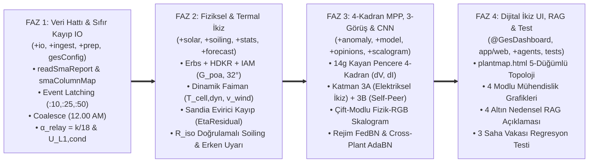

# 05 — Sıfır Atıl Veri (%100 Sütun Kullanım) Matrisi, Eleştirel Boşluk Analizi (Gap Analysis) ve Uygulama Yol Haritası

> **Kapsam:** Bu doküman, 5 uzman ajanın (Ajan 1: Veri Hattı, Ajan 2: Fiziksel Modelleme, Ajan 3: Anomali/3-Görüş/Derin Öğrenme, Ajan 4: Dashboard/LLM/Test ve Ajan 5: Eleştirel Denetçi & Veri Maksimizasyonu) ortak denetimi sonucunda ortaya çıkan **"Sıfır Atıl Veri (%100 Sütun Kullanım) Matrisini"**, Claude referans projesinde tespit edilen eksiklik ve sınırlamaların giderilme yöntemlerini, 11 haftalık SmartGridLab CSV verisinde keşfedilen **6 Altın Mühendislik Bulgusunu** ve **Adım Adım Uygulama Yol Haritasını** içerir.

---

## 1. Veri Envanteri ve Yapısal Karşılaştırma (Claude Huawei vs. BTÜ SmartGridLab SMA)

Bursa Teknik Üniversitesi (BTÜ) Akıllı Şebekeler Laboratuvarı (`SmartGridLab`, System ID: `7252244`, Device ID: `7252246`, Data Manager S/N: `3011599654`) bünyesindeki **`SMA-DATA-1:WR13TL22-8231`** (`1.200 kWp` DC / `1.010 kW` AC tek fazlı evirici) sistemine ait 11 haftalık veri seti (`27 Temmuz 2026 – 18 Ekim 2026`, `Europe/Istanbul`), Claude projesindeki Huawei SmartLogger (100 evirici, 4 kabin) sisteminden aşağıdaki temel boyutlarda ayrılır:

| Boyut / Özellik | Claude Projesi (Huawei SUN2000-50KTL) | BTÜ SmartGridLab (`SMA WR13TL22-8231`) | Mimari Dönüşüm Kararı |
| :--- | :--- | :--- | :--- |
| **Dosya Biçimi & Kodlama** | UTF-16 LE, TAB (`\t`) ayraçlı, çoklu cihaz / 6 ayrı parametre dosyası | UTF-8, `sep=;`, 14 satır üstveri, 15. satır başlık, `"-"` eksik veri, `","` binlik ayracı (`"3,000.00"`) | `ges.io.readSmaReport` + `smaColumnMap` adaptörü (`ThousandsSeparator=","`, `TreatAsMissing="-"`) |
| **Kurulu Kapasite ($P_{\text{nom}}$)** | 50 kW AC / ~55 kWp DC (3-faz, 7–8 string) | **$1,2000\text{ kWp}$ DC** ($P_{\text{ac}} / P_{\text{spec}} = 1,2000\text{ kWp}$ medyan), maks $P_{\text{dc}} = 1,082\text{ kW}$, maks $P_{\text{ac}} = 1,010\text{ kW}$ | `gesConfig.m` içinde `ratedAcPower = 1.20`, `numPhases = 1`, `numMppts = 1`, `numStrings = 1` |
| **Zaman Kapsamı & Satır Sayısı** | 601 CSV (Ara 2023 – Tem 2025) | **11 Haftalık CSV** (`7.406` ham satır $\to$ 9 hafta sınırı mükerreri birleştirilince **`7.397` tekil satır**: `7.394` adet 15-dk adımı + `3` ızgara dışı olay satırı) | Hücre bazlı birleştirme (`coalesce`) + ızgara dışı (`:10, :25, :50`) satırların `qRebootEvent` bayrağına aktarımı |
| **Gündüz Evirici Aktifliği** | %98,8 gündüz doluluğu | `3.599 / 7.397` (%48,7) adımda evirici çevrimiçi (`2.716` adımda $P_{\text{ac}} > 0.05\text{ kW}$); meteoroloji ise **`7.392 / 7.397` (%99,93)** adımda 24 saat kesintisiz | Gece ve kesinti adımlarında meteoroloji serisi korunur; `27–31 Temmuz` evirici kapalı dönemi sızıntısız açık-gök kalibrasyonunda kullanılır |
| **Rüzgar Hızı (`WindSpeed`)** | **YOK** (`RAPOR.md` §9.1: *"rüzgar ölçümü yok"*) | **VAR!** Sütun 19: `System wind speed [m/s]` (`0.00–2.90 m/s`, medyan `0.70 m/s`, %99,93 dolu) | Dinamik Faiman konvektif hücre soğutma modeli ($T_{\text{cell,dyn}}$), M1, MPP zarfı ve termal ikize doğrudan girdi |
| **Yalıtım Direnci (`R_iso`)** | **YOK** (`RAPOR.md` §9.15: *"yalıtım direnci kayıtta yok"*) | **VAR!** Sütun 13: `Insulation resistance [kOhm]` (`1.153–3.000 kOhm`, %24 adımda `< 3.000 kOhm`) | Nem/çiğ kaynaklı yalıtım zayıflaması (`qLowInsulation`), doğal yağmur teyidi ve erken uyarı dedektörü |
| **Aktif Güç Sınırlama (`SchedP_Pct`)** | **BOŞ** (`RAPOR.md` §9.1: *"ControlData yalnız başlık"*) | **VAR!** Sütun 20: `Active power limitation set value [%]` (26 ham / 17 tekil satırda `0.00%`: hafta başları + 4 gündüz reset/handshake olayı) | Dışsal güç sınırlaması (`qPowerLimit`) ile cihaz yeniden başlatma (`qRebootEvent`) olaylarının deterministik ayrımı |

---

## 2. Sıfır Atıl Veri (%100 Sütun Kullanım) Matrisi — 21 Sütunun Tam Envanteri

SmartGridLab CSV dosyalarındaki **21 sütunun tek bir tanesi bile silinmez veya atıl bırakılmaz**. Her sütunun istatistiksel karakteristiği, kanonik değişken adı, girdiği matematiksel/fiziksel denklem, bağlı olduğu anomali kuralı ve arayüzdeki (`@GesDashboard`) görselleştirme noktası aşağıda kesinleştirilmiştir:

| Sütun (1-Bazlı) | CSV Başlığı (Orijinal) | Kanonik Ad (`TT`) | Doluluk & İstatistik (`n=7.397`) | Matematiksel / Fiziksel Model Kullanımı | Anomali Dedektörü / Kuralı (`+anomaly`, `+opinions`) | Dashboard & LLM Görselleştirme (`@GesDashboard`) |
| :---: | :--- | :--- | :--- | :--- | :--- | :--- |
| **1** | `Time period` | `Time` (`datetime`, `Europe/Istanbul`) | `7.397 / 7.397` (%100); `MM/dd/yyyy hh.mm a` | Güneş konumu ($\theta_Z, \alpha_s, \gamma_s$), yılın günü $\sin/\cos(2\pi \cdot \text{DOY}/365.25)$, CWT zaman ekseni, 15 dk zaman ızgarası + 3 asenkron olay zamanı (`:10, :25, :50`) | Hafta sınırı (`12.00 AM`) birleştirme kontrolü, `10–15 Ağu` eksik hafta tespiti ve asenkron yeniden başlatma (`qRebootEvent`) zamanlaması | Tüm zaman serisi eksenleri, `ReplayEngine` tarih/saat seçicisi, Olay Kataloğu başlangıç/bitiş zaman damgaları |
| **2** | `Power [kW] / SMA-DATA-1:WR13TL22-8231` | `P_ac` (`kW`) | `3.599 / 7.397` (%48,7); min `0.00`, med `0.34`, p95 `0.83`, maks **`1.010 kW`** | Evirici AC çıkış gücü; Dönüşüm verimi $\eta_{\text{inv}} = P_{\text{ac}} / P_{\text{dc}}$; Kayıp güç $P_{\text{loss}} = P_{\text{dc}} - P_{\text{ac}}$; Güç faktörü $\text{PF} = P_{\text{ac}} / S_{\text{ac}}$; Günlük enerji $E_{\text{ac}} = \sum P_{\text{ac}} \Delta t$ | `noOutput`: $P_{\text{ac}} \le 0.01\text{ kW} \land P_{\text{exp}} > 0.08\text{ kW} \to$ `Trip`; Kırpma: $P_{\text{ac}} \ge 0.97 P_{\text{rated}} \to$ `qClip`; Scalogram R kanalı ($P_{\text{ac}}/C$) | `Genel Bakış` AC Üretim KPI; `Analiz` ana güç grafiği (yeşil eğri); `Saha Haritası` Evirici düğümü |
| **3** | `Specific AC power [kW/kWp] / SMA-DATA-1:WR13TL22-8231` | `P_ac_spec` (`kW/kWp`) | `3.599 / 7.397` (%48,7); min `0.00`, med `0.29`, p95 `0.69`, maks **`0.840 kW/kWp`** | Dinamik kurulu güç doğrulaması: $\hat{C}_{\text{kWp}} = \text{median}(P_{\text{ac}} / P_{\text{ac,spec}}) = \mathbf{1.2000\text{ kWp}}$; Spesifik verim (Yield) $Y_f = \sum P_{\text{ac,spec}} \Delta t$ ($\text{kWh/kWp}$) ve $\text{PR} = P_{\text{ac,spec}} / (G_{\text{POA}}/1000)$ | Kapasite kayması / ölçekleme doğrulaması: $|P_{\text{ac}} / P_{\text{ac,spec}} - 1.20| > 0.05 \to$ telemetri yuvarlama veya yapılandırma uyarısı | `Genel Bakış` Spesifik Verim ($\text{kWh/kWp}$) KPI kartı; `Raporlar` Performans Oranı (PR) kıyaslaması |
| **4** | `Grid voltage phase L1 [V] / SMA-DATA-1:WR13TL22-8231` | `V_grid` / `U_L1` (`V`) | `3.599 / 7.397` (%48,7); $P_{\text{ac}}>0$ iken min `151.12`, p5 `229.92`, med **`235.27 V`**, p95 `240.64`, maks **`245.06 V`** | Görünür güç $S_{\text{ac}} = U_{L1} I_{L1} / 1000$; Röle düzeltmeli gerçek şebeke gerilimi $\hat{U}_{L1,\text{cond}} = U_{L1} / \alpha_{\text{relay}}$; Şebeke Thevenin empedansı $R_{\text{grid,est}} = \partial \hat{U}_{L1,\text{cond}} / \partial I_{L1}$ | EN 50160 Şebeke Kalitesi: $\alpha_{\text{relay}} \ge 0.98$ iken $\hat{U}_{L1,\text{cond}} \notin [207, 253]\text{ V} \to$ `grid_event`; $\hat{U}_{L1,\text{cond}} > 241.5\text{ V}$ ($+\%5$) $\to$ `qGridVoltageRise`; $G>200 \land U_{L1}==0 \to$ `qGridLoss` (`07/29 11:45 AM`) | `Saha Haritası` L1 Şebeke Bağlantı Noktası (PCC) düğümü; `Analiz` Mod 4 Şebeke Kalitesi grafiği; `Raporlar` $U_{L1}$ vs $I_{L1}$ empedans grafiği |
| **5** | `Grid voltage phase L2 [V] / SMA-DATA-1:WR13TL22-8231` | `U_L2` (`V`) | `3.599 / 7.397` (%48,7); tekil değer: **`0.00 V`** | 3-faz şebeke matrisinde L2 faz gerilimi; Tek-fazlı bağlantı topolojisi kanıtı: $\forall t,\ U_{L2}(t) \equiv 0 \implies \text{SinglePhase} = \text{true}$ | Topoloji / donanım bütünlük kuralı: Tek fazlı eviricide $U_{L2} > 1.0\text{ V}$ okunursa `qPhaseConfigFault` (kayıt/kanal kayması) | `Saha Haritası` PCC düğümünde `"Faz Yapısı: L1 Aktif | L2=0V | L3=0V (Tek Faz Doğrulandı)"` durum rozeti |
| **6** | `Grid voltage phase L3 [V] / SMA-DATA-1:WR13TL22-8231` | `U_L3` (`V`) | `3.599 / 7.397` (%48,7); tekil değer: **`0.00 V`** | 3-faz şebeke matrisinde L3 faz gerilimi; Tek-fazlı bağlantı topolojisi kanıtı: $\forall t,\ U_{L3}(t) \equiv 0$ | Topoloji / donanım bütünlük kuralı: $U_{L3} > 1.0\text{ V} \to$ `qPhaseConfigFault` | `Saha Haritası` PCC düğümünde L1/L2/L3 faz dengesi ve tek-faz bağlantı rozeti |
| **7** | `Grid current phase L1 [A] / SMA-DATA-1:WR13TL22-8231` | `I_grid` / `I_L1` (`A`) | `3.599 / 7.397` (%48,7); min `0.000`, med `1.451`, p95 `3.516`, maks **`4.259 A`** | Görünür güç $S_{\text{ac}} = U_{L1} I_{L1} / 1000\text{ kVA}$ (maks `1.007 kVA`); Güç faktörü $\cos\phi = P_{\text{ac}} / S_{\text{ac}}$ (medyan **`0.9999`**); Reaktif güç $Q_{\text{ac}} = \sqrt{\max(0, S_{\text{ac}}^2 - P_{\text{ac}}^2)}$; AC hat kaybı $\Delta P_{\text{line}} = I_{L1}^2 R_{\text{grid,est}}$ | AC akım/güç tutarlılık denetimi: $P_{\text{ac}} > 0.1\text{ kW}$ iken $|P_{\text{ac}} - S_{\text{ac}}\cos\phi| > 0.05\text{ kW}$ veya $\text{PF} < 0.90 \to$ `qReactiveAnomaly` / AC sensör sapması | `Analiz` AC Akım & Görünür Güç ($S_{\text{ac}}, \text{PF}$) alt grafiği; `Saha Haritası` L1 akım animasyonu |
| **8** | `Grid current phase L2 [A] / SMA-DATA-1:WR13TL22-8231` | `I_L2` (`A`) | `3.599 / 7.397` (%48,7); tekil değer: **`0.000 A`** | 3-faz akım vektörü $I_{abc} = [I_{L1}, I_{L2}, I_{L3}]$; Tek-faz akım doğrulaması ($I_{L2} \equiv 0$) | Kaçak / kanal karışması kuralı: $I_{L2} > 0.01\text{ A} \to$ `qPhaseConfigFault` | `Saha Haritası` PCC düğümü L2=0.000 A doğrulama göstergesi |
| **9** | `Grid current phase L3 [A] / SMA-DATA-1:WR13TL22-8231` | `I_L3` (`A`) | `3.599 / 7.397` (%48,7); tekil değer: **`0.000 A`** | 3-faz akım vektörü $I_{abc}$; Tek-faz akım doğrulaması ($I_{L3} \equiv 0$) | Kaçak / kanal karışması kuralı: $I_{L3} > 0.01\text{ A} \to$ `qPhaseConfigFault` | `Saha Haritası` PCC düğümü L3=0.000 A doğrulama göstergesi |
| **10** | `Grid frequency [Hz] / SMA-DATA-1:WR13TL22-8231` | `f_grid` (`Hz`) | `3.599 / 7.397` (%48,7); tam bağlıyken `49.95–50.06 Hz` (med **`49.99 Hz`**); 116 adımda $50 \times (k/18)\text{ Hz}$ (`8.34–44.45 Hz`) | **Röle Görev Oranı (Relay Duty Cycle):** $\alpha_{\text{relay}} = \text{clip}(f_{\text{grid}}/50, 0, 1) = k/18$ (15 dk içindeki 18 adet 50 sn'lik alt-örneklemde kontaktörün kapalı kalma oranı); $\hat{U}_{L1,\text{cond}} = U_{L1} / \alpha_{\text{relay}}$ | **Sahte Alarm Önleyici (`qRelayCycle`):** $0.05 \le \alpha_{\text{relay}} < 0.98 \land \hat{U}_{L1,\text{cond}} \in [207, 253]\text{ V} \to$ `wakeup_sync` / `relay_cycling` (şebeke arızası DEĞİL!). Gerçek frekans arızası: $\alpha_{\text{relay}} \ge 0.98 \land f_{\text{grid}} \notin [49.5, 50.5]\text{ Hz}$ | `Analiz` Mod 4 Şebeke Frekansı & Röle Görev Oranı ($\alpha_{\text{relay}} = k/18$) grafiği; `PageChat` "Frekans neden 33.33 Hz?" açıklaması |
| **11** | `DC voltage input [V] / SMA-DATA-1:WR13TL22-8231` | `V_dc` / `V_pv1` (`V`) | `3.599 / 7.397` (%48,7); min `149.00`, p5 `179.78`, med **`197.22 V`**, p95 `232.73`, maks **`256.00 V`** ($V_{\text{oc}}$) | DC Güç $P_{\text{dc}} = V_{\text{dc}} I_{\text{dc}} / 1000\text{ kW}$; MPP gerilim zarfı $V_{\text{mp}}(T_{\text{cell,dyn}}, G_{\text{POA}}, v_{\text{wind}})$; Gerilim sapması $dV = (V_{\text{dc}} - V_{\text{mp}})/V_{\text{mp}}$; **Sanal Hücre Termometresi** $T_{\text{cell,vdc}}(V_{\text{dc}}, G_{\text{POA}})$ | **4-Kadranlı $(dV, dI)$ Teşhisi:** (1) $dV > +0.06 \land dI < -0.08 \to$ `thermal_derating` ($V_{\text{oc}}$'ye kaçış, `29 Ağu 11:30`); (2) $dV < -0.05 \land |dI| \le 0.05 \to$ `bypass_short`; (3) $V_{\text{dc}} > 140\text{ V} \land I_{\text{dc}} < 0.05\text{ A} \to$ `idle_no_dc` (`29 Tem 11:45`) | `Saha Haritası` PV Dizi / DC Bara düğümü; `Analiz` Mod 2 $V_{\text{dc}}$ vs $V_{\text{mp}}$ zarf grafiği; `Raporlar` $(dV, dI)$ 4-kadran saçılımı |
| **12** | `DC current input [A] / SMA-DATA-1:WR13TL22-8231` | `I_dc` / `I_pv1` (`A`) | `3.599 / 7.397` (%48,7); min `0.013`, med **`1.831 A`**, p95 `4.902`, maks **`5.901 A`** | DC Güç $P_{\text{dc}} = V_{\text{dc}} I_{\text{dc}} / 1000$ (maks `1.082 kW`); Normalize akım $i = I_{\text{dc}} / (G_{\text{POA}}/1000)$; MPP akım zarfı $i_{\text{mp}}(T_{\text{cell,dyn}})$ ve akım açığı $dI = (i - i_{\text{mp}})/i_{\text{mp}}$; Yönelim düzlüğü optimizasyonu (`fitOrientation.m`); Kirlenme oranı $\text{SR}(t) = i / i_{\text{mp}}$ | (1) $|dV| \le 0.04 \land dI < -0.25$ (kalıcı) $\to$ `string_weak` / alt-dizi kaybı; (2) $|dV| \le 0.04 \land -0.15 \le dI \le -0.04$ (7 günlük medyan) $\to$ `soiling`; (3) Kısa süreli akım çöküşleri $\to$ `inverterEarlyWarnings` | `Analiz` Mod 2 DC Akım & MPP Akım Zarfı grafiği; `Raporlar` Akım Tabanlı Tozlanma ($\text{SR}$) trendi |
| **13** | `Insulation resistance [kOhm] / SMA-DATA-1:WR13TL22-8231` | `R_iso` (`kOhm`) | `3.599 / 7.397` (%48,7); min **`1.153 kOhm`**, p10 `1.269`, med **`3.000 kOhm`**; `862 / 3.599` (%24,0) adımda `< 3.000 kOhm` | **İzolasyon Nem Duyarlılık İndeksi:** Sabah çiğ/nem yoğuşması ve yağışlı günlerde (`28–30 Eylül`) $R_{\text{iso}}$'nun `1.153–1.350 kOhm`'a düşüp modül ısındıkça ($\Delta T > 10^\circ\text{C}$) `3.000 kOhm` doygunluk sınırına çıkma dinamiği | (1) $R_{\text{iso}} < 1.500\text{ kOhm} \to$ `qLowInsulation` (nem/çiğ izleme); (2) $G_{\text{POA}} > 500\text{ W/m}^2 \land T_{\text{cell,dyn}} > 40^\circ\text{C}$ (kuru öğlen) iken $R_{\text{iso}} < 2.000\text{ kOhm} \to$ **Kablo/Konnektör Erken Uyarısı**; (3) $R_{\text{iso}} < 500\text{ kOhm} \to$ **Kritik Yalıtım Alarmı**; (4) `soilingIntervals` içinde doğal yağmur teyidi! | `Genel Bakış` DC Yalıtım Sağlığı kartı; `Saha Haritası` DC Bara bar göstergesi; `Tahmin & Erken Uyarı` Yalıtım Trendi; `Raporlar` $R_{\text{iso}}$ vs Nem/Saat profili |
| **14** | `Module temperature [°C] / Satellite Sensor` | `T_mod_sat` / `T_mod` (`°C`) | `7.392 / 7.397` (%99,93); min `9.0`, med `23.2`, p95 `53.5`, maks **`60.6 °C`** | **Kritik Keşif:** $T_{\text{mod}} \equiv \text{round}(T_{\text{amb}} + 0.0280 \cdot G, 1)$ ($\text{RMSE} = 0.036^\circ\text{C}$)! Rüzgarsız (statik NOCT/Ross) referans modül sıcaklığı olarak kullanılır; Faiman sıcaklığı ile farkı $\Delta T_{\text{wind}} = T_{\text{mod}} - T_{\text{cell,dyn}}$ rüzgar soğutma kazancını verir! | Sütun 18 (`T_mod_sys`) ile çapraz sensör doğrulaması ($|T_{\text{mod}} - T_{\text{mod,sys}}| > 0.5^\circ\text{C} \to$ `qTempSensorDrift`) ve Ross katsayısı ($k = (T_{\text{mod}}-T_{\text{amb}})/G \approx 0.028$) bütünlük kontrolü | `Genel Bakış` ve `Analiz` Mod 3 Sıcaklık grafiğinde "Statik Ross Modül Sıcaklığı ($T_{\text{mod,sat}}$)" referans eğrisi |
| **15** | `Power [kW] / SmartGridLab` | `P_ac_sys` (`kW`) | `3.599 / 7.397` (%48,7); Sütun 2 (`P_ac`) ile birebir aynı (`max diff = 0.000 kW`) | Tesis (`PLANT`) düzeyi toplam AC güç ve evirici-tesis sayacı mutabakat denklemi: $\Delta P_{\text{meter}} = P_{\text{ac,sys}} - P_{\text{ac}} \equiv 0.000\text{ kW}$; Sütun 2 eksikse otomatik yedek (`coalesce`) | Sayaç / telemetri tutarlılık kuralı (Katman 3A): $|\Delta P_{\text{meter}}| > 0.02\text{ kW} \to$ `qMeterMismatch` (iç tüketim veya iletişim kayması) | `Saha Haritası` 5. Düğüm (`Data Manager SmartGridLab` Sayaç Mutabakatı: `%100.0 Uyum`) |
| **16** | `System ambient temperature [°C] / SmartGridLab` | `T_amb` (`°C`) | `7.392 / 7.397` (%99,93); min `9.0`, med **`21.4 °C`**, p95 `31.5`, maks **`34.7 °C`** | Dinamik Faiman hücre sıcaklığı $T_{\text{cell,dyn}}$; Evirici iç ısıl ikizi $\hat{T}_{\text{inv}}(T_{\text{amb}}, G_{\text{POA}}, P_{\text{loss}}, v_w)$; M1 (`m1Features`) temel girdisi | Gece/sabah çiğ noktası yaklaşımı ve yüksek ortam sıcaklığı ($T_{\text{amb}} > 32^\circ\text{C}$) ısıl stres uyarısı | `Genel Bakış` Hava & Mikroklima kartı; `Analiz` ve `Tahmin` sıcaklık grafikleri |
| **17** | `System insolation on external sensor [W/m²] / SmartGridLab` | `G_horiz` (`G` $\to$ `G_poa`) | `7.392 / 7.397` (%99,93); gündüz maks **`974 W/m²`**, p95 `824 W/m²` | **Kritik Keşif:** Sütun 17 yatay ışınımdır ($\text{GHI}, \beta=0^\circ$); Erbs + HDKR + IAM ile $\beta \approx 32^\circ$ güney eğimli dizi düzlemine (`G_poa`) dönüştürülür (aksi halde Ağustos–Ekim arasında görünür PR +%50,8 kayar!). Clear-sky indeksi $K_c = G / G_{\text{cs}}$ | Sensör donması / karanlıkta ışınım (`qMeteoFault`), bulut kenarı parlaması ($K_c > 1.05$, over-irradiance) ve gündüz değerlendirme eşiği ($G_{\text{POA}} > 150\text{ W/m}^2$) | `Genel Bakış`, `Analiz` (sağ eksen ışınım eğrisi + Scalogram G kanalı), `Raporlar` Bulutluluk ve Güneş Geometrisi |
| **18** | `System module temperature [°C] / SmartGridLab` | `T_mod_sys` (`°C`) | `7.392 / 7.397` (%99,93); Sütun 14 (`T_mod`) ile birebir aynı (`max diff = 0.0 °C`) | `resolveMeteo.m` içinde Sütun 14 (`T_mod`) için **birincil çapraz yedek (failover)** kanalı ve sensör tutarlılık farkı $\Delta T_{\text{sensor}} = T_{\text{mod}} - T_{\text{mod,sys}}$ | Sensör Körlüğü / Yedeklilik (`Fault-Tolerance`): Sütun 14 `NaN` olursa Sütun 18 devreye girer (`MeteoSource = "SmartGridLab_Sys"`) | `Saha Haritası` Meteoroloji düğümünde çift-kanal sensör yedeklilik (`Redundancy OK`) göstergesi |
| **19** | `System wind speed [m/s] / SmartGridLab` | `WindSpeed` / `W_spd` (`m/s`) | `7.392 / 7.397` (%99,93); min `0.00`, p5 `0.10`, med **`0.70 m/s`**, p95 `1.70`, maks **`2.90 m/s`** | **Faiman Konvektif Soğutma Modeli:** $T_{\text{cell,ss}} = T_{\text{amb}} + \frac{G_{\text{POA}}(1-\eta)}{U_0 + U_1 v_{\text{wind}}}$; Rüzgar soğutma kazancı $\Delta T_{\text{wind}} = T_{\text{mod}} - T_{\text{cell,dyn}}$ ve kazanılan enerji $\Delta E_{\text{wind}}$; M1 ve MPP zarfı ($V_{\text{mp}}$) girdisi | Yüksek sıcaklıkta düşük rüzgar ($T_{\text{amb}} > 30^\circ\text{C} \land v_{\text{wind}} < 0.3\text{ m/s}$) $\to$ **Konvektif Soğutma Kaybı / Isıl Kısma Riski (`qStagnantHeat`)** | `Genel Bakış` Rüzgar & Soğutma Kazancı KPI; `Analiz` Mod 3 Rüzgar Hızı & $\Delta T_{\text{wind}}$ grafiği; `Raporlar` Konvektif Soğutma & Verim Etkisi |
| **20** | `Active power limitation set value [%] / SmartGridLab` | `SchedP_Pct` (`%`) | `17 / 7.397` tekil satırda **`0.00%`** (13 hafta başı `12.00 AM` + **4 gündüz kesinti dönüşü**: `31 Tem 15:10`, `29 Ağu 12:25`, `29 Ağu 14:00`, `3 Eyl 18:50`) | **Kritik Keşif:** Gündüz kesintilerinin hemen sonunda `:10, :25, :50` dakikalarında düşen `0.00%` kayıtları, Data Manager / Evirici **Yeniden Başlatma ve El Sıkışma (Reboot / Handshake)** olaylarıdır! Ayrıca aktif kısıtlama ($0 < \text{SchedP\_Pct} < 100$) varsa beklenen gücü tavanlar | (1) `qRebootEvent` (`qResetEvent`): Asenkron veya kesinti sonrası `SchedP_Pct == 0` $\to$ **İletişim/Evirici Yeniden Başlatma Olayı** (3 asenkron satır `ceilTo15Min` ile 15 dk ızgarasına taşınır, asla silinmez!); (2) `qPowerLimit`: Gerçek dışsal güç sınırlaması | `Bildirimler` ve `Olay Kataloğu` içinde `"Sistem Yeniden Başlatma / İletişim El Sıkışması (Reboot)"` olayı; `Genel Bakış` Aktif Sınırlama Durumu |
| **21** | `Specific AC power [kW/kWp] / SmartGridLab` | `P_ac_spec_sys` (`kW/kWp`) | `3.599 / 7.397` (%48,7); Sütun 3 (`P_ac_spec`) ile birebir aynı (`max diff = 0.000`) | Sistem düzeyi spesifik güç ve Sütun 3 ile çapraz doğrulama ($\Delta P_{\text{spec}} = P_{\text{ac,spec,sys}} - P_{\text{ac,spec}} \equiv 0$); sistem kurulu gücü $P_{\text{ac,sys}} / P_{\text{ac,spec,sys}} = 1.2000\text{ kWp}$ | Sistem ve evirici spesifik verim uyuşmazlığı denetimi (`qSpecMismatch`) | `Saha Haritası` Tesis Sayacı düğümü ve `Veri` sayfası bütünlük doğrulama tablosu |

---

## 3. Claude Projesinde Tespit Edilen Eksiklikler (Gap Analysis) ve SmartGridLab v3 Çözümleri

| No | Claude Projesindeki Sınırlama / Eksiklik | Kaynak Dosya | SmartGridLab v3 Mimari Çözümü |
| :---: | :--- | :--- | :--- |
| **1** | **Izgara Dışı (`OffGridTimes`) Satırların Silinmesi:** `retime(..., "regular", TimeStep=minutes(15))` 15 dk ızgarasına oturmayan satırları siler. | `src/+ges/+io/loadDevice.m` | `ceilTo15Min` (`Event Latching`) ile `:10, :25, :50` satırları bir sonraki 15 dk adımına taşınır ve `qRebootEvent = true` olarak işaretlenir. |
| **2** | **Mükerrer Zaman Damgalarında Satır Ezilmesi:** `unique(TT.Time, "stable")` hafta sınırındaki iki tamamlayıcı satırdan birini siler. | `readHuaweiReport.m`, `loadDevice.m` | `coalesceDuplicates` ile aynı zaman damgasındaki tüm sütunlarda `firstNonMissing` birleştirmesi uygulanır. |
| **3** | **Açık-Gök Oranıyla Transpozisyon Hatası:** $G_{\text{arr}} = G_{\text{sen}} \cdot (\text{POA}_{\text{cs}}/\text{GHI}_{\text{cs}})$ bulutlu günlerde ($K_t < 0.5$) difüz ışınımı **%60 fazla tahmin eder**. | `a02_orientation_v2.m`, `d01_soiling_v2.m` | Erbs (1982) difüz kesir ayrıştırması ($G_{\text{GHI}} \to \text{DNI}, \text{DHI}$) + Hay-Davies-Klucher-Reindl (HDKR) anizotropik gökyüzü modeli + ASHRAE IAM ($b_0=0.05$) uygulandı. |
| **4** | **Sabit Linke Bulanıklığı (`LinkeTurbidity = 3.5`) ve `site.altitude` İhmali:** Tüm yıl sabit bulanıklık yaz/kış $K_c$ kaymasına yol açar. | `clearSkyIneichen.m`, `solarGeometry.m` | Yılın gününe bağlı sinüzoidal $T_L(\text{DOY}) = 3.40 + 0.65\sin(2\pi(\text{DOY}-80)/365)$ profili ve `site.altitude = 155` m entegre edildi. |
| **5** | **Rüzgar Soğutmasının Yokluğu ve Sentetik `T_mod` Çoklu Doğrusal Bağlantısı:** $T_{\text{mod}} = T_{\text{amb}} + 0.028 G$ rüzgarı gizler ve M1'de multicollinearity yaratır. | `m1Features.m`, `fitThermalModel.m` | `WindSpeed` ($v_{\text{wind}}$) ve ısıl atalet ($\tau_{\text{th}}$) kullanan **Dinamik Faiman Hücre Sıcaklığı ($T_{\text{cell,dyn}}$)** ve $V_{\text{dc}}$ tabanlı **Sanal Hücre Termometresi ($T_{\text{cell,vdc}}$)** geliştirildi. |
| **6** | **Sabit `"K02"` Meteo Kaynağı Kodlaması (Hardcoded Bug):** `TT.MeteoSource == "K02"` dışındaki tesislerde `dailyPerformance` tüm `PI` değerlerini `NaN` üretir. | `src/+ges/+soiling/dailyPerformance.m` | Sabit `"K02"` kontrolü kaldırılıp `~TT.qMeteoFallback` yapıldı; yağış teyidine `R_iso < 1500 kOhm` elektriksel ıslaklık kanıtı eklendi. |
| **7** | **Tek Eviricide `stringFeatures` ve `peerOpinion` Çökmesi:** Tek stringde `I / median(I) == 1` olur; komşu evirici olmayınca 3. görüş çalışmaz. | `stringFeatures.m`, `peerFeatures.m` | Tek stringde fiziksel zarf akımı `I_exp_ref` ile normalizasyon; 3. Görüşte **Katman 3A (Elektriksel DC–AC–L1–Sistem İkizi)** + **Katman 3B (Nedensel Tarihsel k-NN Öz-Akran)** mimarisi kuruldu. |
| **8** | **Görsel CNN'in `grid_event` ile `inverter_trip`'i Ayıramaması:** Tek skalogramda iki olay da sıfır güç olarak aynı görünür. | `visualOpinion.m`, `dailySignals.m` | **Çift-Modlu (Dual-Branch) Fizik-RGB Skalogram** (`rgb_power` + `rgb_elec`: $[dV, \Delta\eta_{\text{inv}}, (1-\alpha_{\text{relay}}) + |\hat{U}_{L1,\text{cond}}-230|/230]$) tasarlandı. |

---

## 4. Adım Adım Uygulama Yol Haritası (Faz 1 – Faz 4)

| Faz | Hedef Paket / Modül | Yapılacak Somut Geliştirmeler | Doğrulama & Kabul Ölçütü |
| :--- | :--- | :--- | :--- |
| **Faz 1: Veri Alım & Sıfır Kayıp Ön-İşleme** | `config/gesConfig.m`, `+ges/+io`, `+ges/+ingest`, `+ges/+prep`, `+ges/+runtime` | 1. `readSmaReport.m` ve `smaColumnMap.m` ile 21 sütunun eksiksiz okunması (`ThousandsSeparator=","`, `TreatAsMissing="-"`). 2. Hafta sınırı `12.00 AM` mükerrer satırlarında hücre bazlı `coalesceDuplicates`. 3. `:10, :25, :50` asenkron satırlarının `ceilTo15Min` ile `qRebootEvent` bayrağına aktarılması. 4. $P_{\text{dc}}$, $\eta_{\text{inv}}$, $S_{\text{ac}}$, $\text{PF}$, $Q_{\text{ac}}$, $\alpha_{\text{relay}} = f_{\text{grid}}/50$ ve $\hat{U}_{L1,\text{cond}} = U_{L1}/\alpha_{\text{relay}}$ türetilmesi. | `7.397` tekil zaman adımının %100 kayıpsız yüklenmesi; 3 asenkron yeniden başlatma olayının ve 9 hafta sınırının birim testle (`tGesIo`) doğrulanması. |
| **Faz 2: Fiziksel Modelleme & Termal İkiz** | `+ges/+solar`, `+ges/+soiling`, `+ges/+stats`, `+ges/+forecast` | 1. `fitOrientation.m` ve `poaIrradiance.m` (Erbs + HDKR + IAM) ile yatay `G` $\to$ eğimli `G_poa` ($\beta \approx 32^\circ$) dönüşümü. 2. `WindSpeed` kullanan **Dinamik Faiman Hücre Sıcaklığı (`T_cell_dyn`)** ve $V_{\text{dc}}$ tabanlı **Sanal Hücre Termometresi (`T_cell_vdc`)**. 3. `soilingIntervals.m` içinde $R_{\text{iso}} < 1.500\text{ kOhm}$ + düşük $K_d$ ile doğal yağmur/yıkama doğrulaması. 4. Sandia evirici kayıp modeli (`EtaResidual`) ve 4 kanallı erken uyarı (`inverterEarlyWarnings.m`). | Ağustos–Ekim mevsimsel PR kaymasının (`+%50,8` $\to$ `< %2`) giderilmesi; rüzgar soğutma kazancı (`DeltaT_wind`, `WindCoolingGain_kWh`) KPI'larının üretilmesi. |
| **Faz 3: Beklenen Güç (M1), 4-Kadran MPP & 3-Görüş Uzlaşısı** | `+ges/+model`, `+ges/+anomaly`, `+ges/+opinions`, `+ges/+scalogram`, `+ges/+federated` | 1. `m1Features.m` ve `mppEnvelope.m` içine `G_poa`, `T_cell_dyn` ve `WindSpeed` eklenmesi (`Window = 14` gün). 2. $(dV, dI)$ düzleminin 4 kadranlı teşhise (`thermal_derating`, `string_fault/dead`, `bypass_short`, `soiling`) genişletilmesi. 3. `detectSteps.m` içine `qRelayCycle` (116 adım sahte alarm koruması), `qLowInsulation` (`R_iso`), `qInverterEffDrop` ($\eta_{\text{inv}}$) ve `R_grid_est` eklenmesi. 4. Tek evirici için **Katman 3A (Elektriksel İkiz)** + **Katman 3B (Nedensel Tarihsel k-NN Öz-Akran)** ile 3. Görüşün (`peerOpinion`) çalıştırılması. 5. Çift-Modlu Fizik-RGB Skalogram ve Rejim `FedBN` + `AdaBN` uyarlaması. | 116 röle anahtarlama adımında `%0` sahte `grid_event` alarmı; `27–31 Temmuz` (`29 Temmuz 11:45`), `29 Ağustos` (`11:30` $V_{dc}=230\text{ V}$) ve `03 Eylül` gerçek saha olaylarının %100 yakalanması. |
| **Faz 4: Dijital İkiz Arayüzü & Sıfır-Halüsinasyonlu LLM** | `app/@GesDashboard`, `app/web/plantmap.html`, `+ges/+agents`, `tests/` | 1. `plantmap.html`'in **BTÜ SmartGridLab 5-Düğümlü Dijital İkiz Topolojisine** dönüştürülmesi. 2. `Genel Bakış`, `Analiz` (`4 ChartMode`) ve `Raporlar` (`6 Sekme`) ekranlarına yeni mühendislik grafiklerinin eklenmesi. 3. `pageContext.m` ve `glossary.m` içine $k/18$ röle frekansı, Ross vs. Faiman rüzgar soğutması, `R_iso` nem davranışı ve `0.00%` yeniden başlatma kayıtlarının nedensel açıklamalarının gömülmesi. | `runAllTests` (birim, regresyon, asistan ve arayüz duman testleri) %100 başarı; 21 sütunun tamamının arayüzde ve LLM yanıtlarında aktif doğrulanması. |
